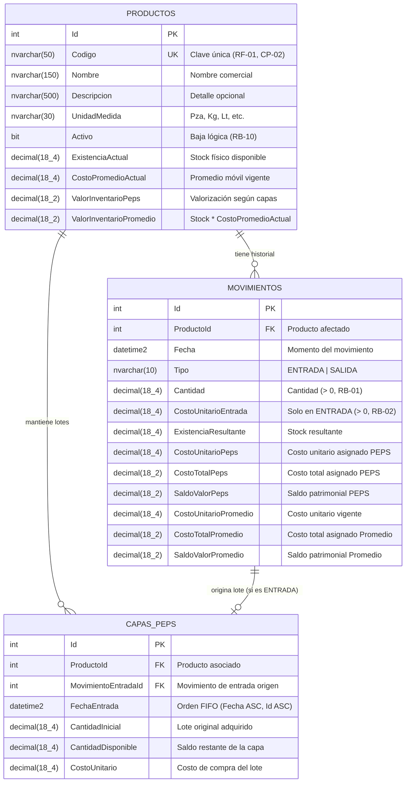

# 📦 Sistema de Inventarios (SI) []

> **Sistema integral de administración y valoración de inventarios con valuación dual (PEPS y Costo Promedio Ponderado Móvil), transacciones ACID y suite exhaustiva de pruebas de software.**

[](https://dotnet.microsoft.com/)
[](https://learn.microsoft.com/dotnet/csharp/)
[](https://learn.microsoft.com/aspnet/core/razor-pages/)
[](https://learn.microsoft.com/ef/core/)
[](https://www.microsoft.com/sql-server)
[](https://www.docker.com/)
[](https://xunit.net/)
[](docs/00-workflow-operativo.md)
[](LICENSE)

---

## 📑 Tabla de Contenidos

1. [Descripción General](#-descripción-general)
2. [Características Principales](#-características-principales)
3. [Stack Tecnológico](#-stack-tecnológico)
4. [Arquitectura y Modelo de Datos](#-arquitectura-y-modelo-de-datos)
5. [Prerrequisitos del Sistema](#-prerrequisitos-del-sistema)
6. [Instalación y Puesta en Marcha](#-instalación-y-puesta-en-marcha)
7. [Uso de Docker para Base de Datos](#-uso-de-docker-para-base-de-datos)
8. [Ejecución de la Aplicación](#-ejecución-de-la-aplicación)
9. [Suite de Pruebas Automatizadas](#-suite-de-pruebas-automatizadas)
10. [Estructura del Repositorio](#-estructura-del-repositorio)
11. [Centro de Documentación (`docs/`)](#-centro-de-documentación-docs)
12. [Flujo de Trabajo y Contribución](#-flujo-de-trabajo-y-contribución)
13. [Licencia](#-licencia)

---

## 💡 Descripción General

El **Sistema de Inventarios (SI)** es una solución web desarrollada en **.NET 8** con **ASP.NET Core Razor Pages** y **Entity Framework Core 8** sobre **SQL Server 2022**. Su objetivo fundamental es proporcionar un control riguroso, verificable y matemáticamente auditable sobre las existencias y la valoración económica de mercancías mediante dos métodos contables estándar:

1. **PEPS (Primeras Entradas, Primeras Salidas / FIFO):** Valuación basada en el consumo cronológico de capas o lotes de adquisición.
2. **Costo Promedio Ponderado Móvil:** Recálculo dinámico y ponderado del costo unitario tras cada entrada de mercancía.

El proyecto está diseñado bajo un paradigma de **Ingeniería de Calidad y Pruebas de Software**, aplicando **Desarrollo Guiado por Pruebas (TDD)**, trazabilidad bidireccional de requisitos a casos de prueba, y ejecución garantizada bajo transacciones ACID con reversión automática (*rollback*) ante fallos.

> [!NOTE]
> Todo el seguimiento del backlog, tickets de desarrollo (SI-001 al SI-047), criterios de aceptación, planes de prueba, casos de prueba y matrices de trazabilidad residen en la carpeta [`docs/`](docs/).

---

## ✨ Características Principales

* **Gestión de Catálogo de Productos:** Alta, edición, consulta y baja lógica con clave única obligatoria (`Codigo`), unidad de medida y estado activo/inactivo (RF-01).
* **Control Transaccional de Movimientos:** Registro estricto de Entradas y Salidas con validación de cantidades positivas, costos válidos y existencia suficiente para evitar saldos negativos (RF-02, RF-03).
* **Valuación Dual en Tiempo Real:** Visualización y comparación del costo de salida y saldo patrimonial del inventario aplicando PEPS y Promedio Ponderado sobre el mismo conjunto histórico de operaciones (RF-04, RF-05).
* **Política de Precisión y Redondeo Bancario:**
  * Uso estricto de aritmética decimal (`decimal` en C# y tipos `decimal(18,4)` / `decimal(18,2)` en SQL Server).
  * Redondeo bancario (*Half to Even* vía `MidpointRounding.ToEven`) para mitigar el sesgo estadístico acumulativo.
  * Cantidades y costos unitarios a 4 decimales; importes totales y saldos a 2 decimales.
  * Ajuste por residuo automático cuando la existencia física llega a cero (saldo valor = 0.00).
* **Persistencia Aislada y Confiable:**
  * Base de datos principal para la aplicación (`SistemaInventarioDb`).
  * Base de datos dedicada y aislada para pruebas de integración (`SistemaInventarioDb_Tests`) en contenedor SQL Server real (sin mocks en memoria).
* **Suite de Pruebas xUnit:** 19 casos de prueba formalmente especificados (CP-01 a CP-19) que cubren pruebas unitarias, de integración, funcionales y de regresión (CP-14).

---

## 🛠️ Stack Tecnológico

| Capa / Rol | Tecnología / Herramienta | Versión | Propósito |
|---|---|---|---|
| **Lenguaje de Programación** | C# | 12.0 | Lenguaje principal de tipado fuerte y alta precisión |
| **Plataforma / Runtime** | .NET SDK | 8.0.x LTS | Runtime y compilador del ecosistema |
| **Framework Web** | ASP.NET Core Razor Pages | 8.0 | Interfaz de usuario basada en componentes de página |
| **ORM / Acceso a Datos** | Entity Framework Core | 8.0 | Mapeo objeto-relacional, migraciones y LINQ |
| **Motor de Base de Datos** | Microsoft SQL Server | 2022 | Almacenamiento relacional transaccional ACID |
| **Contenedores** | Docker & Docker Compose | Engine 24+ | Aislamiento y portabilidad de SQL Server |
| **Framework de Pruebas** | xUnit | 2.5.3+ | Ejecución de pruebas unitarias, integración y regresión |
| **Cobertura de Código** | Coverlet Collector | 6.0.0+ | Métricas de cobertura de código cruzado |

---

## 🏛️ Arquitectura y Modelo de Datos

El diseño del modelo de datos fue optimizado para evitar sobreingeniería y cumplir con los más altos estándares de trazabilidad y rendimiento, utilizando **3 entidades relacionales principales**:



### Reglas Clave de Negocio (RB)

* **RB-01 / RB-02:** Cantidades y costos unitarios de entrada deben ser estrictamente positivos (`> 0`).
* **RB-03:** Salidas superiores a la existencia física disponible son rechazadas sin excepción.
* **RB-06 / RNF-04:** Cualquier operación rechazada o con fallo de ejecución ejecuta `ROLLBACK`, garantizando cero actualizaciones parciales.
* **RB-08 / RB-09:** Redondeo bancario uniforme en memoria C# previo a persistir; tipos con precisión explícita `decimal(18,4)` y `decimal(18,2)`.
* **RB-10:** Prohibido registrar movimientos sobre productos con estado inactivo.

---

## 📋 Prerrequisitos del Sistema

Antes de comenzar, asegúrate de tener instalados los siguientes componentes:

1. **.NET 8 SDK** (v8.0.100 o superior):
   ```bash
   dotnet --version
   ```
2. **Docker Desktop** o **Docker Engine + Docker Compose Plugin**:
   ```bash
   docker --version
   docker compose version
   ```
3. **Git**:
   ```bash
   git --version
   ```
4. *(Opcional)* Herramienta global de Entity Framework Core CLI:
   ```bash
   dotnet tool install --global dotnet-ef
   ```

---

## 🚀 Instalación y Puesta en Marcha

### 1. Clonar el repositorio

```bash
git clone https://github.com/Riguidix/SistemaInventario.git
cd SistemaInventario
```

### 2. Configurar la Base de Datos con Docker

El repositorio incluye un archivo [`docker-compose.yml`](docker-compose.yml) listo para desplegar SQL Server 2022 en segundos:

```bash
docker compose up -d
```

Verifica que el contenedor esté corriendo y saludable:

```bash
docker compose ps
```

> **Credenciales por Defecto del Contenedor:**
> * **Host:** `localhost,1433`
> * **Usuario:** `sa`
> * **Contraseña:** `YourStrong@Passw0rd`
> * **Base de Datos Principal:** `SistemaInventarioDb`
> * **Base de Datos de Pruebas:** `SistemaInventarioDb_Tests`

### 3. Configuración de Conexión (`appsettings.Development.json`)

Verifica o agrega la cadena de conexión en `SI.Web/appsettings.Development.json`:

```json
{
  "ConnectionStrings": {
    "DefaultConnection": "Server=localhost,1433;Database=SistemaInventarioDb;User Id=sa;Password=YourStrong@Passw0rd;TrustServerCertificate=True;MultipleActiveResultSets=true",
    "TestConnection": "Server=localhost,1433;Database=SistemaInventarioDb_Tests;User Id=sa;Password=YourStrong@Passw0rd;TrustServerCertificate=True;MultipleActiveResultSets=true"
  }
}
```

### 4. Aplicar Migraciones / Crear Esquema

Para inicializar la base de datos con las tablas e índices requeridos:

```bash
dotnet ef database update --project SI.Web
```

---

## 🐳 Uso de Docker para Base de Datos

Si prefieres levantar el contenedor de SQL Server de forma individual sin Docker Compose, puedes ejecutar el siguiente comando:

```bash
docker run -e "ACCEPT_EULA=Y" \
           -e "MSSQL_SA_PASSWORD=YourStrong@Passw0rd" \
           -e "MSSQL_PID=Developer" \
           -p 1433:1433 \
           --name sqlserver-inventario \
           -d mcr.microsoft.com/mssql/server:2022-latest
```

### Gestión del Contenedor

* **Detener el servicio:** `docker compose stop`
* **Reiniciar el servicio:** `docker compose start`
* **Eliminar contenedor y preservar datos:** `docker compose down`
* **Eliminar contenedor y purgar volumen de datos:** `docker compose down -v`

---

## 💻 Ejecución de la Aplicación

Para compilar y correr el servidor web localmente:

```bash
dotnet run --project SI.Web
```

Una vez iniciado, abre tu navegador en la URL indicada en la consola:
* **HTTPS:** `https://localhost:7xxx`
* **HTTP:** `http://localhost:5xxx`

### Módulos Disponibles en la Interfaz:
1. **/Productos:** Catálogo con alta, edición, estado y consulta de existencias.
2. **/Movimientos/RegistrarEntrada:** Registro de compras/entradas con cantidad y costo de adquisición.
3. **/Movimientos/RegistrarSalida:** Registro de salidas con validación de stock y costeo automático.
4. **/Inventario/Consulta:** Kardex detallado, capas PEPS activas y comparativa simultánea PEPS vs. Promedio Ponderado.

---

## 🧪 Suite de Pruebas Automatizadas

El proyecto implementa una batería exhaustiva de pruebas en **xUnit** con categorización por atributos `[Trait]` para facilitar la ejecución granular y la trazabilidad (RNF-06):

```csharp
[Trait("CP", "CP-08")]
[Trait("RF", "RF-04")]
[Trait("Nivel", "Unitaria")]
```

### Comandos de Ejecución

#### 1. Ejecutar Toda la Suite de Pruebas
```bash
dotnet test
```

#### 2. Ejecutar por Nivel de Prueba
```bash
# Pruebas Unitarias (Validaciones, redondeo bancario, algoritmos puros de costeo)
dotnet test --filter "Nivel=Unitaria"

# Pruebas de Integración (Persistencia EF Core, índices únicos, transacciones y rollback en SQL Server)
dotnet test --filter "Nivel=Integracion"

# Pruebas Funcionales (Flujos completos de negocio de inicio a fin)
dotnet test --filter "Nivel=Funcional"

# Pruebas de Regresión (Verificación tras resolución de defectos, CP-14)
dotnet test --filter "Nivel=Regresion"
```

#### 3. Ejecutar un Caso de Prueba Específico
```bash
# Ejemplo: Caso de prueba de PEPS (Ejercicio de referencia CP-08)
dotnet test --filter "CP=CP-08"

# Ejemplo: Caso de prueba de Atomicidad y Rollback (CP-13)
dotnet test --filter "CP=CP-13"
```

#### 4. Generar Cobertura de Código y Reporte TRX
```bash
dotnet test --collect:"XPlat Code Coverage" \
            --logger "trx;LogFileName=resultado-pruebas.trx" \
            --results-directory ./evidencias/ciclos
```

---

## 📂 Estructura del Repositorio

```text
SistemaInventario/
├── SistemaInventario.sln           # Solución global .NET 8
├── global.json                     # Versión fijada del SDK de .NET
├── docker-compose.yml              # Configuración oficial de SQL Server 2022
├── LICENSE                         # Licencia del proyecto (MIT)
├── README.md                       # Documentación principal de inicio y ejecución
│
├── SI.Web/                         # Proyecto Principal (ASP.NET Core Razor Pages)
│   ├── Pages/                      # Vistas y PageModels (Productos, Movimientos, Kardex)
│   ├── Costeo/                     # Calculadoras PEPS, Promedio y Política de Redondeo
│   ├── Productos/                  # Servicios de dominio y validadores de producto
│   ├── Movimientos/                # Servicio transaccional y validadores de movimiento
│   ├── Persistencia/               # DbContext, entidades y configuraciones de EF Core
│   ├── appsettings.json            # Configuración general
│   ├── appsettings.Development.json# Cadenas de conexión de desarrollo
│   └── Program.cs                  # Configuración de servicios y pipeline HTTP
│
├── SI.Tests/                       # Proyecto de Pruebas Automatizadas (xUnit)
│   ├── Unitarias/                  # Pruebas de validación, redondeo y fórmulas matemáticas
│   ├── Integracion/                # Pruebas con BD real, persistencia y transacciones ACID
│   ├── Funcionales/                # Pruebas de flujos de negocio end-to-end
│   ├── Regresion/                  # Pruebas de regresión por defectos cerrados (CP-14)
│   └── Fixtures/                   # Configuración y recreación de BD de pruebas
│
├── docs/                           # 📚 Centro de Documentación Formal del Proyecto
│   ├── 00-workflow-operativo.md    # Ciclo de desarrollo TDD (Red → Green → Refactor)
│   ├── 01-plan-de-pruebas.md       # Estrategia, niveles de prueba, roles y cronograma
│   ├── 02-requisitos-y-decisiones.md# Requisitos (RF, RNF), Reglas (RB) y Redondeo
│   ├── 03-diseno-casos-de-prueba.md# Casos de prueba (CP-01 a CP-19) y oráculos calculados
│   ├── 04-matriz-trazabilidad.md   # Matriz bidireccional Requisitos ↔ Casos de Prueba
│   ├── 05-registro-defectos.md     # Bitácora formal de defectos (DEF-001...)
│   ├── 06-informe-ejecucion.md     # Estructura de resultados y estado de ejecución
│   ├── 07-estimacion-esfuerzo.md   # Estimación dual: Story Points y Function Points
│   └── backlog.md                  # Backlog completo de tickets (SI-001 a SI-047)
```

---

## 📚 Centro de Documentación (`docs/`)

Toda la documentación técnica, arquitectónica y de gestión de calidad se encuentra versionada y organizada en el directorio [`docs/`](docs/):

| Documento | Enlace | Descripción y Propósito |
|---|:---:|---|
| **Workflow Operativo** | [Ver documento](docs/00-workflow-operativo.md) | Flujo paso a paso para tomar tickets, ciclo TDD Red-Green, recolección de evidencias y PRs. |
| **Plan de Pruebas y Cronograma** | [Ver documento](docs/01-plan-de-pruebas.md) | Niveles de prueba, ambientes, etiquetado xUnit, roles de equipo (Dev A / Dev B) y cronograma de 7 días. |
| **Requisitos y Decisiones** | [Ver documento](docs/02-requisitos-y-decisiones.md) | Fuente de verdad: RF-01 a RF-05, RNF-01 a RNF-06, RB-01 a RB-11, política de redondeo bancario y bitácora D-01 a D-08. |
| **Diseño de Casos de Prueba** | [Ver documento](docs/03-diseno-casos-de-prueba.md) | Técnicas de diseño (particiones, valores límite, tablas de decisión), oráculos manuales (E-01 a E-03) y fichas CP-01 a CP-19. |
| **Matriz de Trazabilidad** | [Ver documento](docs/04-matriz-trazabilidad.md) | Matriz que mapea cada Requisito y Regla de Negocio con su respectivo Caso de Prueba y método xUnit. |
| **Registro de Defectos** | [Ver documento](docs/05-registro-defectos.md) | Ciclo de vida de defectos encontrados, análisis de causa raíz, severidad y pruebas de regresión asociadas. |
| **Informe de Ejecución** | [Ver documento](docs/06-informe-ejecucion.md) | Resumen del estado de ejecución de los ciclos de pruebas y evidencias generadas. |
| **Estimación de Esfuerzo** | [Ver documento](docs/07-estimacion-esfuerzo.md) | Modelo formal de estimación: Story Points (Fibonacci) para el sprint y Function Points (IFPUG) para métricas de calidad. |
| **Backlog de Tickets** | [Ver documento](docs/backlog.md) | Backlog oficial y detallado con los 47 tickets (SI-001 a SI-047), Definition of Ready, Definition of Done y ruta crítica. |

---

## 🔄 Flujo de Trabajo y Contribución

El equipo opera bajo la metodología **Test-Driven Development (TDD)** con revisión cruzada de código obligatoria:

```
1. Tomar ticket (docs/backlog.md) 
2. Crear rama: feat/SI-XXX-descripcion
3. Escribir prueba xUnit (RED)  commit: test(SI-XXX): red - <descripción>
4. Implementar código (GREEN)   commit: feat(SI-XXX): green - <descripción>
5. Refactorizar con suite verde 
6. Recopilar evidencia en evidencias/CP-XX/
7. Pull Request hacia dev         
8. Revisión y aprobación por el compañero
```

### Convención de Commits Semánticos
* `feat(SI-XXX): <descripción>` — Nueva funcionalidad implementada.
* `test(SI-XXX): <descripción>` — Adición o modificación de pruebas.
* `fix(DEF-XXX): <descripción>` — Corrección de defecto registrado en `docs/05-registro-defectos.md`.
* `docs: <descripción>` — Actualización de documentación.

---

## 📄 Licencia

Este proyecto se distribuye bajo la licencia **MIT**. Consulta el archivo [`LICENSE`](LICENSE) para más detalles.
