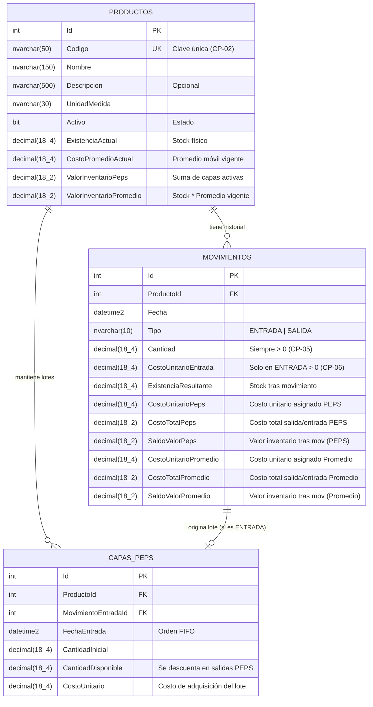

# 🏛️ Arquitectura, Changelog de Features y Backlog de Tickets
**Proyecto:** Sistema de Inventarios con Pruebas de Software (.NET 8 + Razor Pages + EF Core + SQL Server + xUnit)

---

## 1. Modelo de Datos Simplificado (3 Tablas, Cero Sobreingeniería)

Para mantener la base de datos al mínimo indispensable sin sacrificar ningún requisito de la rúbrica, utilizamos **únicamente 3 tablas**:

---

## 2. Changelog Planificado (Hoja de Ruta por Releases)

Este *Changelog* define cómo evoluciona el producto desde el esqueleto inicial hasta el paquete final de entrega:

* **`v0.1.0` — Infraestructura Base y Persistencia (Foundation)**
  * *Features:* Creación de la solución `.sln` con 2 proyectos, `docker-compose.yml` para SQL Server, configuración de `InventarioDbContext` con EF Core 8, definición de las 3 entidades y generación del script SQL (`database/scripts.sql`).
* **`v0.2.0` — Módulo de Productos (RF-01)**
  * *Features:* Registro, consulta, edición y baja lógica de productos; validación de clave única (`Codigo`) y campos obligatorios; pantallas Razor Pages de catálogo de productos.
* **`v0.3.0` — Motor Matemático de Costeo: PEPS y Promedio Ponderado (RF-04)**
  * *Features:* Política de redondeo bancario (`MidpointRounding.ToEven`, 4 decimales internos / 2 visibles), calculadora pura de PEPS por consumo de capas y calculadora pura de Promedio Ponderado Móvil.
* **`v0.4.0` — Módulo de Movimientos Transaccionales y Consultas (RF-02, RF-03, RF-05)**
  * *Features:* Registro de Entradas y Salidas con transacciones ACID (`COMMIT`/`ROLLBACK`), actualización de existencias, recálculo/consulta comparativa de valoración (PEPS vs. Promedio) y vistas Razor Pages de Kardex/Historial.
* **`v0.5.0` — Suite de Pruebas Unitarias, Integración y Funcionales (CP-01 a CP-13)**
  * *Features:* Implementación de casos de prueba automatizados en `xUnit`, verificación del ejercicio obligatorio de referencia (Sección 6.3) y simulación de fallo transaccional (`CP-13`).
* **`v1.0.0` — Ciclo de Defectos, Regresión, Documentación y Empaquetado Final (CP-14)**
  * *Features:* Registro y corrección de defectos reales detectados, suite de regresión, matriz de trazabilidad, informe PDF con evidencias gráficas y archivo `.ZIP` reproducible.

---

## 3. Backlog Detallado de Tickets

> [!TIP]
> **Guía de Asignación para el Equipo:**
> * **🟢 Nivel Básico (Ideal para el compañero menos experimentado en C#):** Lógica directa, validaciones claras, CRUD sencillo o pruebas unitarias siguiendo plantilla.
> * **🟡 Nivel Intermedio:** Páginas Razor con formularios o pruebas de casos de negocio.
> * **🔴 Nivel Avanzado (Arquitecto / Dev con más experiencia en C#):** Configuración de EF Core, transacciones ACID, motor de capas PEPS y pruebas de integración con Docker.

---

### ÉPICA 1: Cimientos y Base de Datos (`v0.1.0`)

#### 🎫 TICKET-01: Inicialización de Solución .NET 8 y Docker SQL Server
* **Nivel:** 🔴 Avanzado
* **Requisito / CP:** RNF-02 (Persistencia), RNF-05 (Mantenibilidad), Entregable 1 y 2.
* **Dónde (Archivos a crear/modificar):**
  * `/SistemaInventarios.sln`
  * `/docker-compose.yml`
  * `/.gitignore`
  * `/src/SistemaInventarios.Web/SistemaInventarios.Web.csproj`
  * `/tests/SistemaInventarios.Tests/SistemaInventarios.Tests.csproj`
* **Qué se debe implementar:**
  1. Crear la solución con los 2 proyectos y referenciar `SistemaInventarios.Web` desde `SistemaInventarios.Tests`.
  2. Crear las 4 carpetas base en `src/SistemaInventarios.Web/`: `Productos/`, `Movimientos/`, `Costeo/`, `Persistencia/`.
  3. Crear las 4 carpetas base en `tests/SistemaInventarios.Tests/`: `Unitarias/`, `Integracion/`, `Funcionales/`, `Regresion/`.
  4. Configurar `docker-compose.yml` con la imagen oficial de SQL Server (`mcr.microsoft.com/mssql/server:2022-latest`), puerto `1433` y contraseña de desarrollo definida en `appsettings.json`.

#### 🎫 TICKET-02: Entidades de Datos, DbContext y Script SQL
* **Nivel:** 🔴 Avanzado
* **Requisito / CP:** RNF-01, RNF-02, Regla de negocio #8 (Precisión decimal).
* **Dónde:**
  * `/src/SistemaInventarios.Web/Productos/Producto.cs`
  * `/src/SistemaInventarios.Web/Movimientos/Movimiento.cs`
  * `/src/SistemaInventarios.Web/Costeo/CapaPeps.cs`
  * `/src/SistemaInventarios.Web/Persistencia/InventarioDbContext.cs`
  * `/database/scripts.sql`
* **Qué se debe implementar:**
  1. Definir las clases `Producto`, `Movimiento` (con enum `TipoMovimiento { Entrada, Salida }`) y `CapaPeps`.
  2. Configurar en `OnModelCreating` de `InventarioDbContext`:
     * Índice único (`HasIndex(p => p.Codigo).IsUnique()`) en `Producto` para garantizar rechazo de duplicados a nivel BD y aplicación.
     * Precisión explícita `HasPrecision(18, 4)` para cantidades y costos unitarios, y `HasPrecision(18, 2)` para importes totales y saldos monetarios.
  3. Generar la primera migración de EF Core y exportar el DDL a `/database/scripts.sql`.

---

### ÉPICA 2: Módulo de Productos (`v0.2.0`)

#### 🎫 TICKET-03: Reglas de Validación y Servicio de Productos (RF-01)
* **Nivel:** 🟢 Básico *(Excelente primer ticket para tu compañero)*
* **Requisito / CP:** RF-01, RNF-03 (Validación con mensajes claros), CP-01, CP-02, CP-11.
* **Dónde:**
  * `/src/SistemaInventarios.Web/Productos/ValidadorProducto.cs`
  * `/src/SistemaInventarios.Web/Productos/ProductoService.cs`
* **Qué se debe implementar:**
  1. En `ValidadorProducto`: validar que `Codigo`, `Nombre` y `UnidadMedida` no sean nulos ni vacíos, y devolver mensajes de error comprensibles en español.
  2. En `ProductoService`:
     * `RegistrarProductoAsync`: verificar con `ValidadorProducto`, comprobar que no exista otro producto con el mismo `Codigo` (lanzando excepción de dominio o resultado de error claro si está duplicado -> **CP-02**) y guardar en BD (**CP-01**).
     * `ObtenerPorIdAsync` / `ObtenerPorCodigoAsync`: devolver el producto o informar claramente que no existe (**CP-11**).
     * `ListarProductosAsync` y `ActualizarProductoAsync` (permitiendo modificar nombre, descripción, unidad de medida y estado activo/inactivo).

#### 🎫 TICKET-04: Interfaz Web de Administración de Productos (Razor Pages)
* **Nivel:** 🟢 Básico / 🟡 Intermedio
* **Requisito / CP:** RF-01, RNF-03.
* **Dónde:**
  * `/src/SistemaInventarios.Web/Pages/Productos/Index.cshtml` (y `.cshtml.cs`)
  * `/src/SistemaInventarios.Web/Pages/Productos/Crear.cshtml` (y `.cshtml.cs`)
  * `/src/SistemaInventarios.Web/Pages/Productos/Editar.cshtml` (y `.cshtml.cs`)
* **Qué se debe implementar:**
  1. Tabla de productos mostrando: Código, Nombre, Descripción, Unidad de Medida, Estado (Activo/Inactivo) y Existencia Actual.
  2. Formulario de alta y edición que muestre en pantalla las alertas de error cuando se intente meter un código duplicado o campos vacíos (ideal para tomar las capturas de pantalla de **CP-01** y **CP-02**).

---

### ÉPICA 3: Motor Matemático de Costeo (`v0.3.0`)

#### 🎫 TICKET-05: Política de Redondeo Bancario y Reglas de Movimiento
* **Nivel:** 🟢 Básico *(Muy formativo y acotado para tu compañero)*
* **Requisito / CP:** Reglas de negocio #1, #2, #8 y #9, CP-05, CP-06.
* **Dónde:**
  * `/src/SistemaInventarios.Web/Costeo/PoliticaRedondeo.cs`
  * `/src/SistemaInventarios.Web/Movimientos/ValidadorMovimiento.cs`
* **Qué se debe implementar:**
  1. En `PoliticaRedondeo`:
     * Método `RedondearCostoUnitario(decimal valor)` -> `Math.Round(valor, 4, MidpointRounding.ToEven)`.
     * Método `RedondearImporteMonetario(decimal valor)` -> `Math.Round(valor, 2, MidpointRounding.ToEven)`.
  2. En `ValidadorMovimiento`:
     * Rechazar cualquier entrada o salida con `Cantidad <= 0` (**CP-05**).
     * Rechazar cualquier entrada con `CostoUnitario <= 0` (**CP-06**).
     * Rechazar cualquier salida donde `Cantidad > ExistenciaDisponible` (**CP-07**).

#### 🎫 TICKET-06: Calculadora de Costo Promedio Ponderado Móvil
* **Nivel:** 🟡 Intermedio
* **Requisito / CP:** RF-04, Sección 6.2, Sección 6.3, CP-09.
* **Dónde:**
  * `/src/SistemaInventarios.Web/Costeo/CalculadoraPromedioPonderado.cs`
  * `/src/SistemaInventarios.Web/Costeo/ResultadoCosteo.cs`
* **Qué se debe implementar:**
  1. Función pura para **Entrada**: recibe `(cantidadAnterior, valorAnterior, cantidadEntrada, costoUnitarioEntrada)` y calcula:
     * `valorEntrada = RedondearImporteMonetario(cantidadEntrada * costoUnitarioEntrada)`
     * `nuevoValorTotal = valorAnterior + valorEntrada`
     * `nuevaCantidadTotal = cantidadAnterior + cantidadEntrada`
     * `nuevoCostoPromedio = RedondearCostoUnitario(nuevoValorTotal / nuevaCantidadTotal)`
  2. Función pura para **Salida**: recibe `(cantidadAnterior, valorAnterior, costoPromedioVigente, cantidadSalida)` y calcula:
     * `costoUnitarioSalida = costoPromedioVigente` (la salida no altera el costo promedio unitario de las unidades restantes).
     * `costoTotalSalida = RedondearImporteMonetario(cantidadSalida * costoUnitarioSalida)`
     * `valorRestante = RedondearImporteMonetario(valorAnterior - costoTotalSalida)`
  3. Método de proyección `RecalcularHistorial(IEnumerable<Movimiento> movimientos)` para reconstruir la tabla completa bajo el método Promedio (**CP-10**).

#### 🎫 TICKET-07: Calculadora de Costeo PEPS (Consumo de Capas FIFO)
* **Nivel:** 🔴 Avanzado
* **Requisito / CP:** RF-04, Sección 6.1, Sección 6.3, CP-08.
* **Dónde:**
  * `/src/SistemaInventarios.Web/Costeo/CalculadoraPeps.cs`
* **Qué se debe implementar:**
  1. Función para **Entrada**: crea una nueva `CapaPeps` con `CantidadInicial = cantidad`, `CantidadDisponible = cantidad` y `CostoUnitario = costoEntrada`.
  2. Función para **Salida**:
     * Recibe las capas con `CantidadDisponible > 0` ordenadas por `FechaEntrada ASC, Id ASC` (la más antigua primero).
     * Recorre las capas consumiendo unidades hasta cubrir la `cantidadSalida` solicitada (soportando salidas que abarquen 1 o múltiples capas).
     * Calcula el `costoTotalSalida` sumando `(unidadesTomadasDeCapa * costoUnitarioCapa)` de cada capa afectada.
     * Calcula el `costoUnitarioSalidaEquivalente = RedondearCostoUnitario(costoTotalSalida / cantidadSalida)`.
     * Calcula el `valorInventarioRestante` sumando `(CantidadDisponible * CostoUnitario)` de las capas sobrevivientes.
  3. Método de proyección `RecalcularHistorial(IEnumerable<Movimiento> movimientos)` para reconstruir el estado PEPS completo desde el historial original (**CP-10**).

---

### ÉPICA 4: Movimientos Transaccionales y Consultas (`v0.4.0`)

#### 🎫 TICKET-08: Servicio Transaccional de Inventario (Entradas, Salidas y Rollback)
* **Nivel:** 🔴 Avanzado
* **Requisito / CP:** RF-02, RF-03, RF-04, RF-05, RNF-01, RNF-04 (Consistencia atómica), CP-03, CP-04, CP-07, CP-10, CP-13.
* **Dónde:**
  * `/src/SistemaInventarios.Web/Movimientos/InventarioService.cs`
* **Qué se debe implementar:**
  1. `RegistrarEntradaAsync(productoId, fecha, cantidad, costoUnitario)`:
     * Verificar existencia del producto (**CP-11**) y validar datos con `ValidadorMovimiento` (**CP-05, CP-06**).
     * Abrir transacción explícita (`await _dbContext.Database.BeginTransactionAsync()`).
     * Calcular impacto en `CalculadoraPeps` y `CalculadoraPromedioPonderado`.
     * Insertar registro en `Movimientos`, insertar nueva capa en `CapasPeps`, actualizar existencias y valores en `Productos`.
     * Confirmar transacción (`CommitAsync`). Si ocurre cualquier excepción, ejecutar `RollbackAsync` garantizando cero cambios parciales (**RNF-04, CP-13**).
  2. `RegistrarSalidaAsync(productoId, fecha, cantidad)`:
     * Verificar producto y validar que `cantidad <= producto.ExistenciaActual` (**CP-07**).
     * Dentro de transacción explícita: consumir capas en `CapasPeps` usando `CalculadoraPeps`, calcular salida en `CalculadoraPromedioPonderado`, insertar el movimiento y actualizar el producto.
  3. `ConsultarEstadoInventarioAsync(productoId, MetodoCosteo metodo)`:
     * Devuelve las existencias actuales, el costo unitario vigente según el método elegido (`PEPS` o `Promedio`), el valor del inventario, las capas PEPS activas y el historial proyectado bajo ese método sin alterar ni duplicar los movimientos originales (**RF-04, RF-05, CP-10**).

#### 🎫 TICKET-09: Interfaz Web de Entradas, Salidas y Consulta Comparativa (Kardex)
* **Nivel:** 🟡 Intermedio
* **Requisito / CP:** RF-02, RF-03, RF-04, RF-05, Sección 6.3.
* **Dónde:**
  * `/src/SistemaInventarios.Web/Pages/Movimientos/RegistrarEntrada.cshtml` (y `.cshtml.cs`)
  * `/src/SistemaInventarios.Web/Pages/Movimientos/RegistrarSalida.cshtml` (y `.cshtml.cs`)
  * `/src/SistemaInventarios.Web/Pages/Inventario/Consulta.cshtml` (y `.cshtml.cs`)
* **Qué se debe implementar:**
  1. Formularios para registrar Entrada y Salida con retroalimentación clara de errores (para evidenciar rechazos de **CP-05, CP-06, CP-07**).
  2. En `Pages/Inventario/Consulta.cshtml`:
     * Un selector/conmutador de Método de Costeo (`PEPS` | `Promedio Ponderado` | `Vista Comparativa Dual`).
     * Tarjetas de resumen con: **Existencias Actuales**, **Costo Unitario (según método)** y **Valor Final del Inventario**.
     * Tabla de historial de movimientos y tabla de capas PEPS activas.
     * Un botón opcional *"Cargar Ejercicio de Referencia 6.3"* para demostrar en vivo ante el profesor el caso obligatorio con un clic.

---

### ÉPICA 5: Estrategia de Pruebas Automatizadas (`v0.5.0`)

#### 🎫 TICKET-10: Pruebas Unitarias de Validación y Redondeo
* **Nivel:** 🟢 Básico *(Ideal para tu compañero)*
* **Requisito / CP:** Sección 7 (Pruebas unitarias), Sección 7.2 (Partición de equivalencia y Valores límite), CP-05, CP-06.
* **Dónde:**
  * `/tests/SistemaInventarios.Tests/Unitarias/ValidadorMovimientoTests.cs`
  * `/tests/SistemaInventarios.Tests/Unitarias/PoliticaRedondeoTests.cs`
* **Qué se debe implementar:**
  1. Pruebas parametrizadas (`[Theory]` / `[InlineData]`) aplicando **Análisis de Valores Límite** en cantidades (`-10`, `-0.0001`, `0`, `0.0001`, `10`) y costos unitarios (`-5`, `0`, `0.01`, `20`).
  2. Pruebas unitarias de `PoliticaRedondeo` verificando el redondeo bancario (`MidpointRounding.ToEven`).

#### 🎫 TICKET-11: Pruebas Unitarias del Motor PEPS y Promedio (Escenario Obligatorio 6.3)
* **Nivel:** 🟡 Intermedio
* **Requisito / CP:** Sección 6.3, Sección 7 (Pruebas unitarias), CP-08, CP-09, CP-10.
* **Dónde:**
  * `/tests/SistemaInventarios.Tests/Unitarias/CalculadoraPepsTests.cs`
  * `/tests/SistemaInventarios.Tests/Unitarias/CalculadoraPromedioTests.cs`
* **Qué se debe implementar:**
  1. Test del **Ejercicio de Referencia 6.3 en PEPS (`CP-08`)**:
     * Entrada 10 a \$20 (\$200) + Entrada 10 a \$30 (\$300) + Salida 5 unidades.
     * Asentar (`Assert`) que: Existencias previas = `20`, Costo unitario salida = `$20.00`, Costo total salida = `$100.00`, Existencias finales = `15`, Valor final = `$400.00`.
  2. Test del **Ejercicio de Referencia 6.3 en Promedio Ponderado (`CP-09`)**:
     * Con los mismos movimientos, asentar que: Existencias previas = `20`, Costo unitario salida = `$25.00`, Costo total salida = `$125.00`, Existencias finales = `15`, Valor final = `$375.00`.
  3. Test de consumo multi-capa en PEPS (ej. retirar 15 unidades que agoten la Capa 1 completa y tomen 5 unidades de la Capa 2).

#### 🎫 TICKET-12: Pruebas de Integración con Base de Datos y Transacciones ACID
* **Nivel:** 🔴 Avanzado
* **Requisito / CP:** Sección 7 (Pruebas de integración), RNF-02, RNF-04, CP-01, CP-02, CP-12, CP-13.
* **Dónde:**
  * `/tests/SistemaInventarios.Tests/Integracion/PersistenciaInventarioTests.cs`
  * `/tests/SistemaInventarios.Tests/Integracion/TransaccionRollbackTests.cs`
* **Qué se debe implementar:**
  1. Verificar que al guardar un producto (`CP-01`) o movimientos, desechar la instancia del `DbContext` (`Dispose`) y abrir una nueva conexión (simulando reinicio de aplicación, `CP-12`), los datos siguen intactos en la base de datos.
  2. Verificar rechazo de clave duplicada (`CP-02`) en la base de datos.
  3. **Prueba del `CP-13` (Provocar fallo durante operación):** Simular una excepción controlada a mitad del registro de un movimiento (después de modificar el stock en memoria/BD pero antes del commit final) y verificar en la base de datos que la transacción hizo `ROLLBACK` y que ni las existencias ni el historial sufrieron modificaciones parciales.

#### 🎫 TICKET-13: Pruebas Funcionales End-to-End de los Casos CP-01 a CP-12
* **Nivel:** 🟡 Intermedio
* **Requisito / CP:** Sección 7 (Pruebas funcionales), CP-01 al CP-12.
* **Dónde:**
  * `/tests/SistemaInventarios.Tests/Funcionales/FlujoInventarioFuncionalTests.cs`
* **Qué se debe implementar:**
  1. Pruebas que ejecuten los flujos completos desde los servicios/handlers verificando el comportamiento observable de principio a fin: alta de producto, entradas, salidas válidas (`CP-03`, `CP-04`), rechazo por falta de stock (`CP-07`), consulta de producto inexistente (`CP-11`) y cambio de método de costeo (`CP-10`) comprobando que las cantidades físicas y el número de transacciones en la tabla `Movimientos` permanecen inalterados.

---

### ÉPICA 6: Gestión de Defectos, Regresión y Entregables (`v1.0.0`)

#### 🎫 TICKET-14: Ciclo de Defectos Reales y Pruebas de Regresión (CP-14)
* **Nivel:** 🟡 Intermedio / 🔴 Avanzado
* **Requisito / CP:** Sección 7.3, CP-14, Rúbrica (10% Defectos y regresión).
* **Dónde:**
  * `/tests/SistemaInventarios.Tests/Regresion/DefectosCorregidosRegresionTests.cs`
  * `/docs/defectos.md`
* **Qué se debe implementar:**
  1. Documentar en `/docs/defectos.md` cada defecto encontrado durante las pruebas iniciales del equipo (con ID, pasos para reproducir, resultado esperado vs obtenido, severidad, captura de evidencia del fallo, causa raíz y commit de corrección).
  2. Crear en `/tests/SistemaInventarios.Tests/Regresion/` una prueba automatizada específica por cada defecto corregido y re-ejecutar toda la suite (`dotnet test`) para demostrar el **CP-14**.

#### 🎫 TICKET-15: Documentación Técnica, ADRs y Matriz de Trazabilidad
* **Nivel:** 🟢 Básico / 🟡 Intermedio *(Pueden dividirlo entre ambos)*
* **Requisito / CP:** RNF-06 (Trazabilidad), Sección 7.1, 7.2 y 9.
* **Dónde:**
  * `/docs/requisitos.md`
  * `/docs/casos-de-prueba.md`
  * `/docs/adr/ADR-001-arquitectura-y-costeo.md`
  * `/README.md`
* **Qué se debe implementar:**
  1. En `requisitos.md`: listado de RF, RNF, Reglas de Negocio y especificación formal de la política de redondeo bancario.
  2. En `casos-de-prueba.md`:
     * Justificación de al menos **2 técnicas de diseño de pruebas** (ej. *Partición de Equivalencia* + *Análisis de Valores Límite* aplicados a cantidades/costos, y *Tablas de Decisión* o *Pruebas basadas en escenarios* aplicadas al motor de costeo).
     * Matriz de trazabilidad (`RF-01..05` y `RNF-01..06` <-> `CP-01..14`).
     * Ficha detallada de los 14 casos de prueba mínimos.
  3. En `README.md`: instrucciones exactas para levantar el contenedor de SQL Server, ejecutar las migraciones/scripts, correr la aplicación (`dotnet run`) y lanzar las pruebas con reporte de cobertura (`dotnet test --collect:"XPlat Code Coverage"`).

#### 🎫 TICKET-16: Generación de Evidencias, Informe PDF y Empaquetado ZIP
* **Nivel:** 🟢 Básico / 🟡 Intermedio
* **Requisito / CP:** Sección 8 (Entregables 1, 2 y 3), Sección 8.1.
* **Dónde:**
  * `/evidencias/`
  * Informe PDF final y archivo `.zip`
* **Qué se debe implementar:**
  1. Ejecutar el sistema y tomar capturas reales explicadas de los casos de prueba (tanto en la interfaz web como consultas a las tablas en SQL Server y consola de ejecución de `xUnit`).
  2. Compilar el Informe en PDF con los 11 puntos de la sección 8.1.
  3. Empaquetar el `.zip` verificando que no existan rutas absolutas (`C:\Users\...` o `/Users/...`) y que funcione en limpio.
