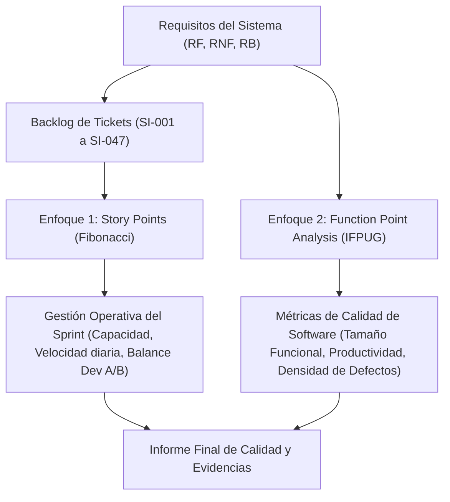
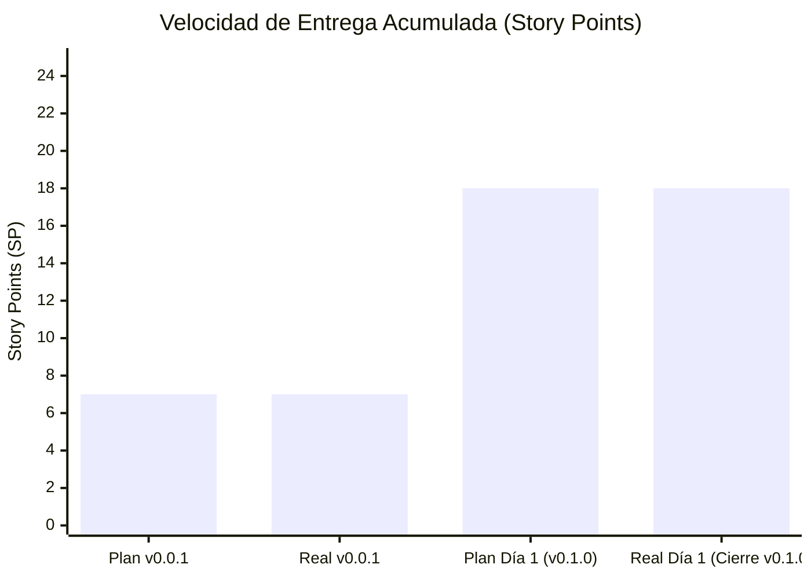

# 07 · Modelo y Estimación de Esfuerzo de Software

**Proyecto:** Sistema de Inventarios con PEPS y Costo Promedio Ponderado móvil  
**Rol:** Senior Project Manager & Quality Assurance Lead  
**Fecha:** 16-oct-2026 · **Ciclo:** v0.0.1 → v1.0.0 (Duración: 1 Semana / 7 Días)  
**Equipo:** 2 Desarrolladores (Dev A: Núcleo/Backend · Dev B: Producto/QA/UI)  

---

## 1. Marco Metodológico de Estimación

Para garantizar una planificación realista, rigurosa y defendible ante cualquier auditoría o evaluación académica, aplicamos un **enfoque de doble estimación complementario**:



1. **Story Points (Ágil / Operativo - Planning Poker Fibonacci):** Modela el **esfuerzo relativo**, la **complejidad técnica** y la **incertidumbre** para la ejecución diaria del equipo durante la semana de trabajo.
2. **Function Point Analysis (Métrico / Formal - Estándar IFPUG / ISO/IEC 20926):** Modela el **tamaño funcional intrínseco del software**, libre de sesgos tecnológicos, permitiendo justificar la productividad (Horas/FP) y normalizar la tasa de defectos (Defectos/FP) en el informe final.

---

## 2. Enfoque 1: Estimación por Story Points (Fibonacci)

### 2.1 Calibración de la Escala (Historias Ancla / Golden References)

| Puntos (SP) | Nivel de Esfuerzo | Criterio Técnico | Ticket de Referencia (Ancla) |
|:---:|:---|:---|:---|
| **1 SP** | Trivial / Muy Bajo | Validación aislada, ajuste de configuración o función pura directa con 1-2 casos de prueba. | `SI-013` (Validación de costo unitario) / `SI-002` (Higiene del repositorio). |
| **2 SP** | Bajo | Algoritmo matemático básico con fórmula cerrada o CRUD estándar sin transacciones complejas. | `SI-015` (Cálculo promedio entradas) / `SI-021` (Consulta y listado de productos). |
| **3 SP** | Medio | Algoritmo con múltiples ramas lógicas, componente UI Razor interactivo con formularios y validación, o CRUD con persistencia relacional. | `SI-017` (PEPS creación y consumo simple) / `SI-023` (UI administración productos) / `SI-030` (UI movimientos). |
| **5 SP** | Alto | Operaciones transaccionales ACID multi-tabla, consumo recursivo/iterativo de capas FIFO con residuo bancario, o simulación de fallos con rollback. | `SI-018` (PEPS multicapa) / `SI-024` (Entradas transaccionales) / `SI-025` (Salidas transaccionales) / `SI-026` (Atomicidad y rollback). |
| **8 SP** | Muy Alto / Complejo | Suites completas de pruebas funcionales End-to-End o integración formal de informe técnico con trazabilidad y evidencias gráficas. | `SI-036` (Pruebas funcionales de flujo completo) / `SI-046` (Informe PDF final con evidencias). |

---

### 2.2 Estimación Detallada Ticket por Ticket (SI-001 a SI-047)

| ID | Título del Ticket | Release | Resp. | Horas | Story Points (SP) | Justificación de Complejidad & Incertidumbre |
|:---|:---|:---:|:---:|:---:|:---:|:---|
| **SI-001** | Cerrar decisiones pendientes y ejercicio referencia | v0.0.1 | Ambos | 1.0 h | **2 SP** | ✅ **Completado (main)**: Decisiones D-01..D-10 y oráculo E-01 confirmados. |
| **SI-002** | Higiene del repositorio | v0.0.1 | Dev A | 0.5 h | **1 SP** | ✅ **Completado (main)**: `.gitignore`, ramas base y limpieza. |
| **SI-003** | Contenedor SQL Server soportado | v0.0.1 | Dev A | 1.0 h | **2 SP** | ✅ **Completado (main)**: `compose.yaml` y ConnectionString configurados. |
| **SI-004** | Proyecto de pruebas conectado por nivel | v0.0.1 | Dev A | 0.5 h | **1 SP** | ✅ **Completado (main)**: `SI.Tests` conectado y organizado con xUnit. |
| **SI-005** | Convenciones de trabajo y plantilla PR | v0.0.1 | Dev B | 0.5 h | **1 SP** | ✅ **Completado (main)**: PR template + CI GitHub Actions integrado. |
| **SI-006** | Corrección precisión modelo producto (DEF-001) | v0.1.0 | Dev A | 1.0 h | **2 SP** | ✅ **Completado (branch)**: `HasPrecision(18,4)` / `(18,2)` + test de regresión. |
| **SI-007** | Modelo de datos de movimientos | v0.1.0 | Dev A | 1.5 h | **3 SP** | ✅ **Completado**: Entidad relacional con 13 columnas, índices y claves foráneas. |
| **SI-008** | Modelo de datos de capas PEPS | v0.1.0 | Dev A | 1.0 h | **2 SP** | ✅ **Completado**: Entidad de soporte FIFO con relación a producto y movimiento. |
| **SI-009** | Creación reproducible de la base de datos | v0.1.0 | Dev A | 0.5 h | **1 SP** | ✅ **Completado**: Script SQL `init.sql` idempotente verificado. |
| **SI-010** | Base de datos de pruebas aislada | v0.1.0 | Dev A | 2.0 h | **3 SP** | ✅ **Completado**: Fixture xUnit con auto-migración/limpieza contra SQL Server real. |
| **SI-011** | Política de redondeo bancario | v0.2.0 | Dev B | 1.0 h | **2 SP** | ✅ **Completado**: `MidpointRounding.ToEven` a 4 y 2 decimales con tests parametrizados (`PoliticaRedondeo`). |
| **SI-012** | Validación de cantidades | v0.2.0 | Dev B | 1.0 h | **2 SP** | ✅ **Completado**: Rechazo de ≤0 y verificación de límite de 4 decimales (`ValidadorCantidad`). |
| **SI-013** | Validación de costo unitario | v0.2.0 | Dev B | 0.5 h | **1 SP** | ✅ **Completado**: Rechazo de costos negativos, cero o > 4 decimales (`ValidadorCostoUnitario`). |
| **SI-014** | Validación de existencia suficiente | v0.2.0 | Dev B | 0.5 h | **1 SP** | ✅ **Completado**: Comparación estricta cantidad salida vs existencia física (`ValidadorExistencia`). |
| **SI-015** | Promedio ponderado: entradas | v0.2.0 | Dev B | 1.0 h | **2 SP** | ✅ **Completado**: Fórmula de promedio ponderado para entradas con redondeo bancario (`CalculadoraPromedioPonderado.CalcularEntrada`). |
| **SI-016** | Promedio ponderado: salidas y residuo | v0.2.0 | Dev B | 1.5 h | **3 SP** | ✅ **Completado**: Salidas a costo vigente, agotamiento de stock y ajuste por residuo D-03 (`CalculadoraPromedioPonderado.CalcularSalida`). |
| **SI-017** | PEPS: creación y consumo simple | v0.2.0 | Dev A | 1.5 h | **3 SP** | ✅ **Completado**: Lógica FIFO para lote único, cálculo de saldo remanente y valor total (`CalculadoraPeps`). |
| **SI-018** | PEPS: salida multicapa y agotamiento | v0.2.0 | Dev A | 2.0 h | **5 SP** | Algoritmo de consumo iterativo sobre múltiples capas y orden FIFO. |
| **SI-020** | Registrar producto | v0.3.0 | Dev B | 2.0 h | **3 SP** | Servicio de negocio + validación duplicados + prueba de persistencia. |
| **SI-021** | Consultar y listar productos | v0.3.0 | Dev B | 1.0 h | **2 SP** | Manejo de producto inexistente, filtros de estado. |
| **SI-022** | Modificar producto y cambiar estado | v0.3.0 | Dev B | 1.5 h | **2 SP** | Modificación de metadatos, preservación de clave e historial. |
| **SI-023** | UI administración de productos | v0.3.0 | Dev B | 3.0 h | **5 SP** | Formularios Razor, validaciones cliente/servidor, alertas visuales. |
| **SI-024** | Registrar entrada con transacción | v0.4.0 | Dev A | 3.0 h | **5 SP** | Coordinación atómica: Producto + Movimiento + Capa + Commit EF. |
| **SI-025** | Registrar salida con transacción | v0.4.0 | Dev A | 3.0 h | **5 SP** | Coordinación atómica: Consumo PEPS + Promedio + Actualización stock. |
| **SI-026** | Atomicidad ante fallos (Rollback) | v0.4.0 | Dev A | 2.0 h | **3 SP** | Inyección de fallo de prueba y verificación de invariabilidad en BD. |
| **SI-027** | Persistencia tras reinicio | v0.4.0 | Dev A | 1.0 h | **2 SP** | Verificación de relectura con contextos limpios e idempotencia. |
| **SI-028** | Invariante de valores almacenados | v0.4.0 | Dev A | 1.5 h | **3 SP** | Pruebas de coherencia matemática: Stock = Capas = Historial. |
| **SI-029** | Rechazo de fechas retroactivas | v0.4.0 | Dev A | 1.0 h | **2 SP** | Regla de negocio de integridad temporal en movimientos. |
| **SI-030** | UI registro de entradas y salidas | v0.4.0 | Dev B | 3.0 h | **5 SP** | Formularios Razor, selección dinámica, captura de errores. |
| **SI-031** | Consulta existencias por método | v0.5.0 | Dev A | 2.0 h | **3 SP** | Servicio de proyección dual (PEPS vs Promedio) sin alterar datos. |
| **SI-032** | Historial de movimientos por método | v0.5.0 | Dev A | 1.5 h | **3 SP** | Formateo de Kardex según método seleccionado con saldos exactos. |
| **SI-033** | UI consulta de inventario e historial | v0.5.0 | Dev B | 3.0 h | **5 SP** | Pantalla principal Kardex, selector dual, tabla de capas activas. |
| **SI-034** | Carga ejercicio de referencia en UI | v0.5.0 | Dev B | 1.0 h | **2 SP** | Botón de demostración rápida para la evaluación. |
| **SI-035** | Vista comparativa PEPS vs Promedio | v0.5.0 | Dev B | 1.5 h | **2 SP** | Cuadro comparativo simultáneo de valoración y costos. |
| **SI-036** | Pruebas funcionales flujo completo | v0.9.0 | Dev A | 3.0 h | **5 SP** | Automatización E2E de CP-01 a CP-19 contra base real. |
| **SI-037** | Feature freeze y release candidate | v0.9.0 | Ambos | 0.5 h | **1 SP** | Congelamiento de código, etiquetado de tag Git v0.9.0-rc.1. |
| **SI-038** | Ciclo 1: ejecución manual CP-01 a CP-10 | v0.9.0 | Dev B | 3.0 h | **5 SP** | Ejecución en UI, recolección de capturas y verificación SQL. |
| **SI-039** | Ciclo 1: ejecución manual CP-11 a CP-19 | v0.9.0 | Dev A | 3.0 h | **5 SP** | Pruebas de límites, reinicios reales y pruebas transaccionales. |
| **SI-040** | Revisión de mantenibilidad (RNF-05) | v0.9.0 | Dev B | 1.0 h | **2 SP** | Análisis de responsabilidades, reporte de cobertura con Coverlet. |
| **SI-041** | Triage de defectos del Ciclo 1 | v0.9.x | Ambos | 1.0 h | **2 SP** | Clasificación de severidad y priorización de fixes. |
| **SI-042** | Corrección de defectos (Buffer) | v0.9.x | Ambos | 4.0 h | **5 SP** | Ciclo TDD correctivo para anomalías encontradas. |
| **SI-043** | Ciclo 2: regresión completa (CP-14) | v0.9.x | Dev B | 2.0 h | **3 SP** | Re-ejecución total de la suite de pruebas y cierre de defectos. |
| **SI-044** | README de instalación y ejecución | v1.0.0 | Dev A | 1.5 h | **2 SP** | Documentación para reproducibilidad en limpio por evaluadores. |
| **SI-045** | Informe de ejecución con datos reales | v1.0.0 | Dev B | 2.0 h | **3 SP** | Consolidación métrica y de tablas de resultados obtenidos. |
| **SI-046** | Informe PDF final con evidencias | v1.0.0 | Dev B | 4.0 h | **5 SP** | Integración formal de evidencias visuales, SQL y xUnit. |
| **SI-047** | Clon limpio, empaque ZIP y tag final | v1.0.0 | Dev A | 1.5 h | **2 SP** | Validación de portabilidad en carpeta limpia, hash v1.0.0. |
| **TOTAL** | **46 Tickets Activos** | — | — | **77.0 h** | **118 SP** | **Backlog Completo Calibrado** |

---

### 2.3 Capacidad, Velocidad y Balance del Equipo

#### Capacidad del Sprint (1 Semana)
- **Días laborales:** 7 días continuos (sábado 17 al viernes 23 de octubre de 2026).
- **Recursos:** 2 ingenieros a tiempo dedicado (Dev A y Dev B).
- **Jornada de foco efectivo estimada:** ~5.5 a 6.0 horas/día por persona (descontando pausas y revisiones cruzadas).
- **Capacidad Total en Horas:** $2 \text{ devs} \times 7 \text{ días} \times 6 \text{ h/día} = \mathbf{84.0\text{ horas}}$.
- **Horas Requeridas en Backlog:** $\mathbf{77.0\text{ horas}}$ (Margen de contingencia: 7.0 h = 8.3%).

#### Velocidad Estimada (Sprint Velocity)
- **Total Story Points:** $\mathbf{118\text{ SP}}$.
- **Velocidad de entrega diaria requerida:** $\frac{118\text{ SP}}{7\text{ días}} \approx \mathbf{16.8\text{ SP/día del equipo}}$ (~8.4 SP/día por desarrollador).

#### Balance de Carga entre Integrantes
```
Dev A (Núcleo, EF Core, Transacciones, Pruebas Integración):
  Horas Estimadas: 39.5 h  |  Story Points: 60 SP (50.8%)

Dev B (Validaciones, Promedio, UI Razor, Fichas QA, Informe):
  Horas Estimadas: 37.5 h  |  Story Points: 58 SP (49.2%)
```
*El balance de carga es óptimo (50.8% vs 49.2%), evitando cuellos de botella en cualquiera de los dos roles.*

---

### 2.4 Seguimiento Real del Sprint: Velocidad Observada vs. Estimada (Corte Día 1 / Release v0.1.0)

Al cierre de la Release de Datos y Ambiente de Pruebas (`v0.1.0`), se registran las métricas reales del equipo:

| Métrica | Estimación Planificada (Día 1) | Real Ejecutado (Corte `v0.1.0`) | Desviación / Estado |
|:---|:---:|:---:|:---:|
| **Release Base v0.0.1** | 7 SP (SI-001 a SI-005) | **7 SP entregados y en main** | **0% desviación (En tiempo)** |
| **Release Datos v0.1.0** | 11 SP (SI-006 a SI-010) | **11 SP entregados y verificados** | **0% desviación (En tiempo)** |
| **Horas Totales Día 1** | ~9.5 horas planeadas | ~9.0 horas reales | Ejecución eficiente y dentro del rango |
| **Valor Adicional Incorporado** | No planificado | **Pipeline CI GitHub Actions + Fixture real SQL Server** | Mayor robustez y confiabilidad en CI |
| **Story Points Acumulados Cerrados** | 18 SP | **18 SP** (7 SP v0.0.1 + 11 SP v0.1.0) | **100% Día 1 Completado** |
| **Tasa de Cierre de Defectos** | 0 defectos | **1 defecto corregido (`DEF-001`)** | Detección y solución temprana |



*Conclusión del PM:* El equipo cerró al 100% los compromisos del **Día 1 (18 SP)**, dejando la base de datos de producción y de pruebas (`SistemaInventarioDb_Tests`) operativas, reproducibles y aisladas, listas para iniciar la implementación de las reglas de costeo puras de la Release `v0.2.0`.

---

## 3. Enfoque 2: Function Point Analysis (FPA - IFPUG / ISO/IEC 20926)

El conteo de Puntos de Función mide el tamaño lógico del software entregado al usuario, clasificando los requerimientos en funciones de datos y transaccionales.

### 3.1 Funciones de Datos (Data Functions)

#### 1. Archivos Lógicos Internos (ILF - Internal Logical Files)
Grupos de datos lógicamente relacionados mantenidos enteramente dentro de la frontera de la aplicación:

| ILF | Descripción | RET (Tipos de Registro) | DET (Campos de Datos) | Complejidad IFPUG | Puntos de Función |
|:---|:---|:---:|:---:|:---:|:---:|
| **ILF-01: Productos** | Catálogo maestro de productos con existencias y saldos consolidados. | 1 (Cabecera) | 10 (`Id`, `Codigo`, `Nombre`, `Descripcion`, `UnidadMedida`, `Activo`, `ExistenciaActual`, `CostoPromedioActual`, `ValorInventarioPeps`, `ValorInventarioPromedio`) | **Baja** (1 RET, <20 DET) | **7 FP** |
| **ILF-02: Movimientos** | Historial de transacciones de inventario con costeo dual. | 1 (Kardex) | 13 (`Id`, `ProductoId`, `Fecha`, `Tipo`, `Cantidad`, `CostoUnitarioEntrada`, `ExistenciaResultante`, `CostoUnitarioPeps`, `CostoTotalPeps`, `SaldoValorPeps`, `CostoUnitarioPromedio`, `CostoTotalPromedio`, `SaldoValorPromedio`) | **Media** (1 RET, 20-50 DET eq. / cálculos) | **10 FP** |
| **ILF-03: Capas PEPS** | Lotes de inventario disponibles para el método FIFO. | 1 (Lote) | 7 (`Id`, `ProductoId`, `MovimientoEntradaId`, `FechaEntrada`, `CantidadInicial`, `CantidadDisponible`, `CostoUnitario`) | **Baja** (1 RET, <20 DET) | **7 FP** |
| **Total ILF** | — | — | — | — | **24 FP** |

#### 2. Archivos de Interfaz Externa (EIF - External Interface Files)
- En este MVP de alcance acotado no existen integraciones con sistemas externos de facturación o ERP: **0 FP**.

---

### 3.2 Funciones Transaccionales (Transactional Functions)

#### 1. Entradas Externas (EI - External Inputs)
Procesos elementales que reciben datos desde fuera de la frontera de la aplicación y mantienen ILFs:

| EI | Requisito | ILF Afectados | DET Procesados | Complejidad IFPUG | Puntos de Función |
|:---|:---:|:---:|:---:|:---:|:---:|
| **EI-01: Registrar Producto** | RF-01 | 1 (Productos) | 5 (Código, Nombre, Descripción, Unidad, Estado) | **Baja** | **3 FP** |
| **EI-02: Modificar Producto** | RF-01 | 1 (Productos) | 5 (Nombre, Descripción, Unidad, Estado, Id) | **Baja** | **3 FP** |
| **EI-03: Registrar Entrada** | RF-02 | 3 (Productos, Movimientos, CapasPeps) | 6 (Fecha, ProductoId, Cantidad, CostoUnitario, Existencia, Valor) | **Alta** (3 ILFs tocados) | **6 FP** |
| **EI-04: Registrar Salida** | RF-03 | 3 (Productos, Movimientos, CapasPeps) | 5 (Fecha, ProductoId, Cantidad, Existencia, Costo) | **Alta** (3 ILFs tocados) | **6 FP** |
| **Total EI** | — | — | — | — | **18 FP** |

#### 2. Salidas Externas (EO - External Outputs)
Procesos elementales que envían datos fuera de la frontera y ejecutan procesamiento lógico matemático o recalculan valores derivados:

| EO | Requisito | ILF Consultados | DET de Salida | Complejidad IFPUG | Puntos de Función |
|:---|:---:|:---:|:---:|:---:|:---:|
| **EO-01: Historial Kardex PEPS** | RF-04, RF-05 | 2 (Movimientos, Capas) | 8 (Fecha, Tipo, Cant, C.U. PEPS, Costo Tot, Saldo Cant, Saldo Val, Capas) | **Media** | **5 FP** |
| **EO-02: Historial Kardex Promedio** | RF-04, RF-05 | 2 (Movimientos, Productos) | 8 (Fecha, Tipo, Cant, C.U. Prom, Costo Tot, Saldo Cant, Saldo Val, Promedio) | **Media** | **5 FP** |
| **EO-03: Resumen Valuación Dual** | RF-04, RF-05 | 2 (Productos, Movimientos) | 7 (Existencia, C.U. PEPS, Valor PEPS, C.U. Prom, Valor Prom, Delta) | **Media** | **5 FP** |
| **Total EO** | — | — | — | — | **15 FP** |

#### 3. Consultas Externas (EQ - External Inquiries)
Procesos de recuperación inmediata de información sin alterar ILFs ni ejecutar fórmulas complejas derivadas:

| EQ | Requisito | ILF Consultados | DET Procesados | Complejidad IFPUG | Puntos de Función |
|:---|:---:|:---:|:---:|:---:|:---:|
| **EQ-01: Consulta/Búsqueda Producto** | RF-01 | 1 (Productos) | 6 (Id, Código, Nombre, Unidad, Estado, Existencia) | **Baja** | **3 FP** |
| **EQ-02: Consulta Capas Activas PEPS** | RF-04, RF-05 | 1 (CapasPeps) | 5 (LoteId, Fecha, CantidadInicial, CantidadDisponible, Costo) | **Baja** | **3 FP** |
| **Total EQ** | — | — | — | — | **6 FP** |

---

### 3.3 Conteo de Puntos de Función No Ajustados (UFP)

$$\text{UFP} = \text{ILF} + \text{EIF} + \text{EI} + \text{EO} + \text{EQ}$$
$$\text{UFP} = 24 + 0 + 18 + 15 + 6 = \mathbf{63\text{ Puntos de Función No Ajustados (UFP)}}$$

---

### 3.4 Factor de Ajuste de Complejidad Técnica (VAF)

Evaluamos las 14 Características Generales del Sistema (GSC - General System Characteristics) en escala de 0 (no presente) a 5 (fuerte influencia):

| # | Característica General del Sistema (GSC) | Grado (0-5) | Justificación de la Ponderación |
|:---:|:---|:---:|:---|
| 1 | Comunicación de datos | **2** | Aplicación web local (.NET 8 Kestrel / Docker). |
| 2 | Procesamiento distribuido | **1** | Frontend/Backend monolítico + SQL Server en contenedor local. |
| 3 | Rendimiento | **2** | Operaciones atómicas de inventario en tiempo real. |
| 4 | Configuración de equipamiento | **2** | Requiere Docker Compose y .NET SDK en ambiente estándar. |
| 5 | Tasa de transacciones | **2** | Moderada para entorno de inventario MVP. |
| 6 | Entrada de datos en línea | **4** | Captura continua en formularios Razor interactivos. |
| 7 | Eficiencia del usuario final | **3** | Retroalimentación clara de validaciones y rechazos. |
| 8 | Actualización en línea | **5** | **Crítica**: Actualización inmediata e instantánea de capas y promedios. |
| 9 | Complejidad de procesamiento | **5** | **Crítica**: Aritmética decimal de precisión, redondeo bancario, consumo FIFO multicapa y rollback ACID. |
| 10 | Reusabilidad del código | **3** | Arquitectura orientada a servicios y calculadoras desacopladas. |
| 11 | Facilidad de instalación | **4** | Despliegue automatizado con Docker y scripts SQL reproducibles. |
| 12 | Facilidad de operación | **4** | Procedimientos documentados paso a paso para el evaluador. |
| 13 | Localizaciones múltiples | **1** | Moneda y formato regional estándar único. |
| 14 | Facilidad de cambios | **4** | Arquitectura con pruebas de regresión automatizadas que facilitan refactor. |
| **TOTAL** | **Suma de Grados de Influencia (TDI)** | **40** | — |

El Factor de Ajuste de Valor (VAF) se calcula como:
$$\text{VAF} = 0.65 + (0.01 \times \text{TDI}) = 0.65 + (0.01 \times 40) = \mathbf{1.05}$$

### 3.5 Puntos de Función Ajustados (AFP)

$$\text{AFP} = \text{UFP} \times \text{VAF} = 63 \times 1.05 = \mathbf{66.15 \approx 66\text{ Puntos de Función Ajustados (AFP)}}$$

---

## 4. Comparativa Cruzada y Ratios de Productividad

| Métrica | Valor del Proyecto | Ratio / Benchmark de la Industria (.NET / C#) | Observación del Senior PM |
|:---|:---:|:---:|:---|
| **Puntos de Función (AFP)** | **66 FP** | — | Tamaño representativo para un MVP especializado en calidad. |
| **Story Points (SP)** | **118 SP** | — | Refleja alta granularidad de testing (TDD, suites automatizadas). |
| **Horas Totales Estimadas** | **77.0 horas** | — | Enfoque de entrega ajustado a 7 días calendario. |
| **Productividad (Horas / FP)** | **1.17 h / FP** | 8 a 15 h/FP (proyectos corporativos estándar) | La productividad es alta debido al alcance acotado y a la ausencia de burocracia administrativa. |
| **Relación SP / FP** | **1.79 SP / FP** | 1.5 a 2.2 SP / FP | Coincide con la relación observada en proyectos con desarrollo dirigido por pruebas (TDD). |

---

## 5. Directrices de Control para el Senior Project Manager

1. **Monitoreo Diario de Velocidad (Burn-down):** Al finalizar cada jornada (D1 a D7), se computarán los Story Points efectivamente cerrados en estado `Hecho` (con DoD cumplido). Si la velocidad acumulada cae por debajo de 15 SP/día, se activará el **Plan de Recorte** documentado en la Sección 5 del [Backlog](backlog.md).
2. **Uso de Métricas en el Informe Final:** La cifra de **66 Puntos de Función Ajustados** se utilizará en el Informe de Calidad (documento `06`) como denominador para calcular la densidad de defectos:
   $$\text{Densidad de Defectos} = \frac{\text{Defectos Totales Detectados}}{\text{Puntos de Función (66 FP)}}$$
   Demostrando así el rigor del aseguramiento de calidad exigido por la rúbrica.
