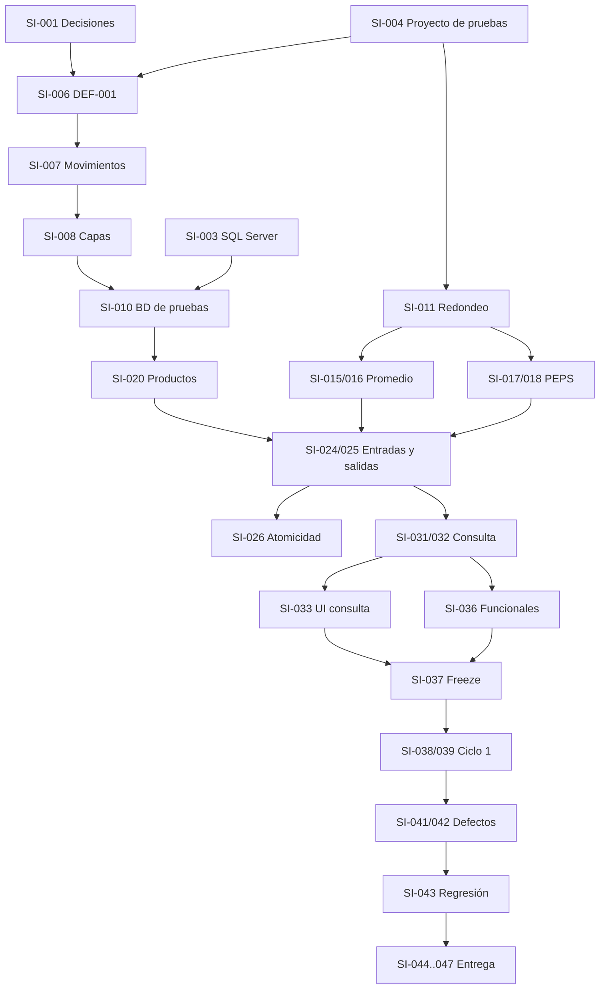

# 🗂️ Backlog del Proyecto — v0.0.1 → v1.0.0

**Proyecto:** Sistema de Inventarios con PEPS y Costo Promedio Ponderado móvil
**Equipo:** Dev A (Núcleo) · Dev B (Producto y QA) · **Ventana:** sáb 17 → vie 23 de octubre de 2026
**Documentos relacionados:** [Plan de pruebas](01-plan-de-pruebas.md) · [Requisitos y decisiones](02-requisitos-y-decisiones.md) · [Diseño de casos](03-diseno-casos-de-prueba.md) · [Trazabilidad](04-matriz-trazabilidad.md) · [Defectos](05-registro-defectos.md) · [Informe](06-informe-ejecucion.md) · [Estimación de Esfuerzo](07-estimacion-esfuerzo.md)

> Este backlog define **qué** se entrega y **cómo se sabe que está terminado**. No define la arquitectura: cada ticket deja libertad de implementación siempre que cumpla sus criterios de aceptación. Reemplaza a la sección 3 del `README.md` (ver SI-044).

---

## 1. Cómo usar este backlog

### 1.1 Anatomía de un ticket

| Campo | Significado |
|---|---|
| **Release** | Versión en la que se entrega (git tag al cerrar la release) |
| **Responsable** | Dev A, Dev B o Ambos. Quien **no** lo construyó lo revisa en el PR |
| **Día** | Día planeado del cronograma (D1 = sáb 17 … D7 = vie 23) |
| **Est.** | Estimación en horas de trabajo efectivo |
| **Prioridad** | **Must** (obligatorio) · **Should** (importante, se puede degradar a manual) · **Could** (recortable) |
| **Objetivo** | Por qué existe el ticket |
| **Criterios de aceptación** | Condiciones verificables. **Todas** deben cumplirse |
| **Trazabilidad** | Requisitos, reglas, casos de prueba y defectos relacionados |
| **Depende de** | Tickets que deben estar terminados antes |
| **Evidencia** | Qué se guarda en `evidencias/` para el informe |

### 1.2 Definition of Ready (antes de empezar un ticket)
- [ ] Sus dependencias están en **Hecho**
- [ ] Los resultados esperados que necesita ya están en `03-diseno-casos-de-prueba.md`
- [ ] No hay decisiones pendientes que afecten sus criterios

### 1.3 Definition of Done (para cerrar un ticket)
- [ ] Rama `feat/SI-XXX-descripcion` con flujo TDD: commit **RED** → commit **GREEN**
- [ ] Pruebas etiquetadas con `[Trait("CP", …)]`, `[Trait("RF", …)]` y `[Trait("Nivel", …)]`
- [ ] `dotnet build` sin advertencias nuevas · `dotnet test` con **toda** la suite en verde
- [ ] Ninguna regla de negocio vive solo en la interfaz
- [ ] PR hacia `dev` revisado y aprobado por el otro integrante
- [ ] Documentos afectados actualizados (decisiones, fichas, matriz)
- [ ] Mensajes de commit con el ID del ticket: `feat(SI-017): consumo de capa PEPS`

### 1.4 Estados
`Por hacer` → `En curso` → `En revisión (PR)` → `Hecho` · (`Bloqueado` con la causa indicada)

---

## 2. Hoja de ruta de releases

```mermaid
flowchart LR
    R001["v0.0.1 Arranque"] --> R010["v0.1.0 Datos y ambiente de pruebas"]
    R010 --> R020["v0.2.0 Reglas y motor de costeo"]
    R020 --> R030["v0.3.0 Productos"]
    R020 --> R040["v0.4.0 Movimientos transaccionales"]
    R030 --> R040
    R040 --> R050["v0.5.0 Consulta e interfaz"]
    R050 --> R090["v0.9.0-rc Feature freeze y Ciclo 1"]
    R090 --> R09x["v0.9.x Defectos y regresión"]
    R09x --> R100["v1.0.0 Entrega"]
```

| Release | Día | Tema | Criterio de salida (para crear el tag) |
|---|---|---|---|
| **v0.0.1** | D1 mañana | Arranque | Decisiones cerradas · repo limpio · SQL Server levanta · `dotnet test` ejecuta una prueba real |
| **v0.1.0** | D1 | Datos y ambiente de pruebas | Esquema completo con precisiones correctas · DEF-001 corregido · BD de pruebas operativa |
| **v0.2.0** | D2 | Reglas y motor de costeo | Validaciones, redondeo, PEPS y Promedio en verde contra los escenarios E-01, E-02 y E-03 |
| **v0.3.0** | D3 | Productos | RF-01 completo (servicio + interfaz) · CP-01, CP-02, CP-11 en verde |
| **v0.4.0** | D3–D4 | Movimientos transaccionales | RF-02 y RF-03 completos · CP-03, 04, 05, 06, 07, 12, 13, 16, 18, 19 en verde |
| **v0.5.0** | D4–D5 | Consulta e interfaz | RF-04 y RF-05 completos · CP-08, 09, 10 verificados de punta a punta |
| **v0.9.0-rc.1** | D5 18:00 | 🔒 Feature freeze | Suite en verde · a partir de aquí solo entran correcciones de defectos |
| **v0.9.x** | D6 | Defectos y regresión | Ciclo 1 documentado · defectos críticos y altos corregidos · Ciclo 2 ejecutado |
| **v1.0.0** | D7 | Entrega | README ejecutable · informe PDF · ZIP verificado en clon limpio · repo, ZIP y PDF del mismo commit |

---

## 3. Tablero resumen

| ID | Título | Release | Resp. | Día | Est. | Prior. | Estado      |
|---|---|---|---|---|---|---|-------------|
| SI-001 | Cerrar decisiones pendientes y confirmar el ejercicio de referencia | v0.0.1 | Ambos | D1 | 1 | Must | TERMINADO   |
| SI-002 | Higiene del repositorio | v0.0.1 | A | D1 | 0.5 | Must | TERMINADO   |
| SI-003 | Contenedor de SQL Server con imagen soportada | v0.0.1 | A | D1 | 1 | Must | TERMINADO   |
| SI-004 | Proyecto de pruebas conectado y organizado por nivel | v0.0.1 | A | D1 | 0.5 | Must | TERMINADO   |
| SI-005 | Convenciones de trabajo y plantilla de PR | v0.0.1 | B | D1 | 0.5 | Should | TERMINADO   |
| SI-006 | Corregir precisión del modelo de producto (DEF-001) | v0.1.0 | A | D1 | 1 | Must | TERMINADO   |
| SI-007 | Modelo de datos de movimientos | v0.1.0 | A | D1 | 1.5 | Must | TERMINADO   |
| SI-008 | Modelo de datos de capas PEPS | v0.1.0 | A | D1 | 1 | Must | TERMINADO   |
| SI-009 | Creación reproducible de la base de datos | v0.1.0 | A | D1 | 0.5 | Must | TERMINADO   |
| SI-010 | Base de datos de pruebas aislada | v0.1.0 | A | D1 | 2 | Must | TERMINADO   |
| SI-011 | Política de redondeo bancario | v0.2.0 | B | D1 | 1 | Must | TERMINADO   |
| SI-012 | Validación de cantidades | v0.2.0 | B | D1 | 1 | Must | TERMINADO  |
| SI-013 | Validación de costo unitario | v0.2.0 | B | D1 | 0.5 | Must | TERMINADO   |
| SI-014 | Validación de existencia suficiente | v0.2.0 | B | D1 | 0.5 | Must | TERMINADO   |
| SI-015 | Promedio ponderado: entradas | v0.2.0 | B | D2 | 1 | Must | TERMINADO   |
| SI-016 | Promedio ponderado: salidas y ajuste por residuo | v0.2.0 | B | D2 | 1.5 | Must | TERMINADO   |
| SI-017 | PEPS: creación de capas y salida de una capa | v0.2.0 | A | D2 | 1.5 | Must | TERMINADO   |
| SI-018 | PEPS: salida multicapa y agotamiento | v0.2.0 | A | D2 | 2 | Must | TERMINADO   |
| SI-020 | Registrar producto | v0.3.0 | B | D3 | 2 | Must | TERMINADO   |
| SI-021 | Consultar y listar productos | v0.3.0 | B | D3 | 1 | Must | Por hacer   |
| SI-022 | Modificar producto y cambiar su estado | v0.3.0 | B | D3 | 1.5 | Must | Por hacer   |
| SI-023 | Interfaz de administración de productos | v0.3.0 | B | D4 | 3 | Must | Por hacer   |
| SI-024 | Registrar entrada con transacción | v0.4.0 | A | D3 | 3 | Must | Por hacer   |
| SI-025 | Registrar salida con transacción | v0.4.0 | A | D3 | 3 | Must | Por hacer   |
| SI-026 | Atomicidad ante fallos | v0.4.0 | A | D3 | 2 | Must | Por hacer   |
| SI-027 | Persistencia tras reinicio | v0.4.0 | A | D4 | 1 | Must | Por hacer   |
| SI-028 | Invariante de valores almacenados | v0.4.0 | A | D4 | 1.5 | Must | Por hacer   |
| SI-029 | Rechazo de fechas retroactivas | v0.4.0 | A | D4 | 1 | Should | Por hacer   |
| SI-030 | Interfaz de registro de entradas y salidas | v0.4.0 | B | D4 | 3 | Must | Por hacer   |
| SI-031 | Consulta de existencias por método de costeo | v0.5.0 | A | D4 | 2 | Must | Por hacer   |
| SI-032 | Historial de movimientos por método | v0.5.0 | A | D4 | 1.5 | Must | Por hacer   |
| SI-033 | Interfaz de consulta de inventario e historial | v0.5.0 | B | D5 | 3 | Must | Por hacer   |
| SI-034 | Carga del ejercicio de referencia desde la interfaz | v0.5.0 | B | D5 | 1 | Could | Por hacer   |
| SI-035 | Vista comparativa PEPS vs Promedio | v0.5.0 | B | D5 | 1.5 | Could | Por hacer   |
| SI-036 | Pruebas funcionales de flujo completo | v0.9.0-rc | A | D5 | 3 | Must | Por hacer   |
| SI-037 | Feature freeze y release candidate | v0.9.0-rc | Ambos | D5 | 0.5 | Must | Por hacer   |
| SI-038 | Ciclo 1: ejecución manual de CP-01 a CP-10 | v0.9.0-rc | B | D5–D6 | 3 | Must | Por hacer   |
| SI-039 | Ciclo 1: ejecución manual de CP-11 a CP-19 | v0.9.0-rc | A | D6 | 3 | Must | Por hacer   |
| SI-040 | Revisión de mantenibilidad (RNF-05) | v0.9.0-rc | B | D6 | 1 | Must | Por hacer   |
| SI-041 | Triage de defectos del Ciclo 1 | v0.9.x | Ambos | D6 | 1 | Must | Por hacer   |
| SI-042 | Corrección de defectos (reserva) | v0.9.x | Ambos | D6 | 4 | Must | Por hacer   |
| SI-043 | Ciclo 2: regresión completa (CP-14) | v0.9.x | B | D6 | 2 | Must | Por hacer   |
| SI-044 | README de instalación y ejecución | v1.0.0 | A | D7 | 1.5 | Must | Por hacer   |
| SI-045 | Informe de ejecución con resultados reales | v1.0.0 | B | D7 | 2 | Must | Por hacer   |
| SI-046 | Informe PDF final | v1.0.0 | B | D7 | 4 | Must | Por hacer   |
| SI-047 | Verificación en clon limpio, ZIP y tag v1.0.0 | v1.0.0 | A | D7 | 1.5 | Must | Por hacer   |

> El ID SI-019 queda reservado (la valoración por método se cubre en SI-028 y SI-031).

### 3.1 Capacidad

| | Dev A | Dev B | Total |
|---|---|---|---|
| Horas planeadas | ≈ 40 h | ≈ 37 h | ≈ 77 h |
| Capacidad estimada (7 días × ~6 h efectivas) | 42 h | 42 h | 84 h |
| **Holgura** | ~2 h | ~5 h | **~7 h (8 %)** |

> ⚠️ La holgura es mínima. Si al cierre del **D4** alguna release va con más de medio día de retraso, se aplica el **plan de recorte** (sección 5).

---

## 4. Detalle de tickets

---

### 🟦 v0.0.1 — Arranque

#### SI-001 · Cerrar decisiones pendientes y confirmar el ejercicio de referencia
`v0.0.1` · **Ambos** · D1 · 1 h · **Must**

**Objetivo:** que ningún ticket arranque con supuestos abiertos que cambien sus resultados esperados.

**Criterios de aceptación:**
- [X] D-01 (cantidades decimales y máximo 4 decimales), D-03 (ajuste por residuo) y D-04 (fechas retroactivas) quedan en estado ✅ o ❌ en `02-requisitos-y-decisiones.md`
- [X] D-09 (costo unitario PEPS a mostrar) y D-10 (código de producto inmutable) quedan decididos
- [X] El ejercicio de referencia E-01 se compara con la sección 6.3 del enunciado; si difiere, se corrigen E-01 y las fichas CP-08, CP-09 y CP-10
- [X] Roles Dev A y Dev B asignados con nombre en `01-plan-de-pruebas.md`
- [X] Fecha y hora exacta de entrega confirmadas

**Trazabilidad:** todas las RB · CP-08, CP-09, CP-10
**Depende de:** —
**Evidencia:** bitácora de decisiones actualizada

---

#### SI-002 · Higiene del repositorio
`v0.0.1` · **Dev A** · D1 · 0.5 h · **Must**

**Objetivo:** que el repositorio solo contenga lo necesario para construir y probar el sistema, sin archivos personales ni rutas de una máquina concreta.

**Criterios de aceptación:**
- [X] `.gitignore` excluye archivos personales del IDE (`*.DotSettings.user`, `.idea` de usuario), `Library/`, `.local/`, `bin/`, `obj/` y resultados de pruebas
- [X] El trabajo pendiente de `feat/database` queda commiteado o descartado de forma explícita
- [X] La carpeta `docs/` queda versionada
- [X] Un `git clone` nuevo seguido de `git status` sale limpio

**Trazabilidad:** Entregable ZIP / repositorio coherente
**Depende de:** —
**Evidencia:** —

---

#### SI-003 · Contenedor de SQL Server con imagen soportada
`v0.0.1` · **Dev A** · D1 · 1 h · **Must**

**Objetivo:** eliminar el riesgo de la imagen `azure-sql-edge` retirada (H-05) y garantizar que el evaluador pueda levantar la base de datos.

**Criterios de aceptación:**
- [X] `docker compose up -d` levanta SQL Server con una imagen oficial soportada
- [X] La aplicación se conecta con la cadena configurada
- [X] Ambos integrantes lo verificaron en sus equipos
- [X] Los datos persisten al reiniciar el contenedor (volumen)

**Trazabilidad:** RNF-02 · H-05
**Depende de:** —
**Evidencia:** captura de `docker compose ps` con el contenedor saludable

---

#### SI-004 · Proyecto de pruebas conectado y organizado por nivel
`v0.0.1` · **Dev A** · D1 · 0.5 h · **Must**

**Objetivo:** que las pruebas puedan usar el código de la aplicación y queden separadas por nivel (H-03).

**Criterios de aceptación:**
- [X] El proyecto de pruebas referencia al proyecto web
- [X] Existen las agrupaciones Unitarias, Integración, Funcionales y Regresión
- [X] Se elimina la prueba vacía de plantilla
- [X] `dotnet test` ejecuta al menos una prueba real que usa código de la aplicación
- [X] `dotnet test --filter "Nivel=Unitaria"` filtra correctamente

**Trazabilidad:** RNF-06
**Depende de:** —
**Evidencia:** salida de consola de `dotnet test`

---

#### SI-005 · Convenciones de trabajo y plantilla de PR
`v0.0.1` · **Dev B** · D1 · 0.5 h · **Should**

**Objetivo:** que ambos trabajen igual y que el historial de git sirva como evidencia del proceso.

**Criterios de aceptación:**
- [X] Hay una plantilla de PR con el checklist de la Definition of Done
- [X] La convención de ramas (`feat/SI-XXX-…`, `fix/DEF-XXX-…`) y de commits (`test(SI-XXX): red …`, `feat(SI-XXX): …`, `fix(DEF-XXX): …`) está documentada en `01-plan-de-pruebas.md`
- [X] Se acuerda que `dev` solo recibe PRs con la suite en verde

**Trazabilidad:** CP-14 (evidencia del proceso)
**Depende de:** —
**Evidencia:** —

---

### 🟩 v0.1.0 — Datos y ambiente de pruebas

#### SI-006 · Corregir precisión del modelo de producto (DEF-001)
`v0.1.0` · **Dev A** · D1 · 1 h · **Must**

**Objetivo:** que costos unitarios, cantidades e importes se almacenen con la precisión definida en la política (§5.2 de `02`).

**Criterios de aceptación:**
- [X] **RED:** una prueba verifica la precisión de las columnas del producto y falla con el esquema actual
- [X] Las existencias se guardan con 4 decimales, el costo promedio con 4 y los valores de inventario con 2
- [X] Una nueva migración aplica el cambio sobre una BD existente sin errores
- [X] **GREEN:** la prueba de esquema pasa
- [X] DEF-001 en `05-registro-defectos.md` queda en estado *Corregido*, con commit y evidencia antes/después

**Trazabilidad:** RB-08, RB-09 · DEF-001 · CP-19
**Depende de:** SI-001 (D-01), SI-004
**Evidencia:** `evidencias/DEF-001/` (esquema antes y después, prueba RED y GREEN)

---

#### SI-007 · Modelo de datos de movimientos
`v0.1.0` · **Dev A** · D1 · 1.5 h · **Must**

**Objetivo:** guardar cada entrada y salida con los datos que exige RB-04 y con los resultados de ambos métodos de costeo, para poder consultarlos y auditarlos.

**Criterios de aceptación:**
- [X] Cada movimiento guarda producto, fecha, tipo (entrada o salida), cantidad y costo unitario de adquisición (solo entradas)
- [X] Cada movimiento guarda, **para cada método**, el costo unitario aplicado, el costo total y el saldo de valor resultante, además de la existencia resultante
- [X] La relación con el producto es obligatoria y no permite borrar un producto con movimientos
- [X] Las precisiones siguen la política (§5.2)
- [X] La migración se aplica sin errores

**Trazabilidad:** RF-02, RF-03, RF-05 · RB-04, RB-05, RB-08
**Depende de:** SI-006
**Evidencia:** diagrama o captura del esquema generado

---

#### SI-008 · Modelo de datos de capas PEPS
`v0.1.0` · **Dev A** · D1 · 1 h · **Must**

**Objetivo:** mantener las capas de inventario con su cantidad disponible y su costo, como exige la definición de PEPS.

**Criterios de aceptación:**
- [X] Cada capa guarda producto, movimiento de entrada que la originó, fecha, cantidad inicial, cantidad disponible y costo unitario
- [X] Las capas pueden recuperarse en orden de antigüedad (fecha y, a igualdad de fecha, orden de registro)
- [X] La cantidad disponible nunca puede quedar negativa (validación o restricción en la BD)
- [X] La migración se aplica sin errores

**Trazabilidad:** RF-04 · RB-07
**Depende de:** SI-007
**Evidencia:** captura del esquema

---

#### SI-009 · Creación reproducible de la base de datos
`v0.1.0` · **Dev A** · D1 · 0.5 h · **Must**

**Objetivo:** que cualquiera pueda crear la base de datos desde cero con instrucciones claras.

**Criterios de aceptación:**
- [X] Con un solo comando documentado se crea la BD completa en una instancia vacía
- [X] El script SQL de referencia se regenera y coincide con las migraciones vigentes
- [X] Probado borrando la BD y recreándola

**Trazabilidad:** RNF-02 · Entregable "la aplicación puede ejecutarse siguiendo las instrucciones"
**Depende de:** SI-008
**Evidencia:** `SI.Web/Data/Scripts/init.sql`

---

#### SI-010 · Base de datos de pruebas aislada
`v0.1.0` · **Dev A** · D1 · 2 h · **Must**

**Objetivo:** que las pruebas de integración corran contra SQL Server real (D-06) sin contaminar la BD de la aplicación ni depender del orden de ejecución.

**Criterios de aceptación:**
- [X] Las pruebas de integración usan una BD dedicada (`SistemaInventarioDb_Tests`) que se crea y migra automáticamente
- [X] Cada prueba parte de un estado conocido (sin datos residuales de otras pruebas)
- [X] La cadena de conexión de pruebas es configurable y no está atada a una máquina
- [X] **No** se usa el proveedor InMemory en ninguna prueba de integración
- [X] Una prueba de humo inserta y lee un producto usando un contexto nuevo

**Trazabilidad:** D-06 · base de CP-01, 02, 12, 13, 19
**Depende de:** SI-003, SI-008
**Evidencia:** `docs/evidencias/SI-010/BD_Pruebas_Aisladas.md` y salida de `dotnet test --filter "Nivel=Integracion"`

---

### 🟨 v0.2.0 — Reglas y motor de costeo

> Todos los tickets de esta release son **funciones puras** con pruebas unitarias. No requieren base de datos.

#### SI-011 · Política de redondeo bancario
`v0.2.0` · **Dev B** · D1 · 1 h · **Must**

**Objetivo:** un único punto que aplique la política de redondeo (§5 de `02`) para que sea uniforme en todo el sistema (RB-09).

**Criterios de aceptación:**
- [X] Hay redondeo de costo unitario a 4 decimales y de importe a 2, ambos bancarios (`ToEven` explícito)
- [X] Pruebas parametrizadas con la tabla 5.1: `10.005 → 10.00`, `10.015 → 10.02`, `10.0051 → 10.01`, `50.025 → 50.02`
- [X] Pruebas a 4 decimales: `10.00005 → 10.0000`, `10.00015 → 10.0002`
- [X] Ningún otro componente redondea por su cuenta (se revisa en el PR)

**Trazabilidad:** RB-08, RB-09 · CP-17
**Depende de:** SI-004
**Evidencia:** salida de las pruebas

---

#### SI-012 · Validación de cantidades
`v0.2.0` · **Dev B** · D1 · 1 h · **Must**

**Objetivo:** rechazar cantidades inválidas con mensajes comprensibles antes de tocar datos.

**Criterios de aceptación:**
- [X] Se rechazan `-1`, `0` y `0.00001` (más de 4 decimales)
- [X] Se aceptan `0.0001` y `1`
- [X] Mensajes en español y comprensibles (ej. "La cantidad debe ser mayor que cero", "La cantidad no puede tener más de 4 decimales")
- [X] Aplica igual a entradas y salidas

**Trazabilidad:** RB-01 · RNF-03 · CP-05
**Depende de:** SI-001 (D-01)
**Evidencia:** salida de las pruebas con los valores límite

---

#### SI-013 · Validación de costo unitario
`v0.2.0` · **Dev B** · D1 · 0.5 h · **Must**

**Objetivo:** impedir entradas con costo negativo, cero o con precisión no soportada.

**Criterios de aceptación:**
- [X] Se rechazan `-0.01`, `0` y valores con más de 4 decimales
- [X] Se aceptan `0.0001` y `0.01`
- [X] Mensaje comprensible ("El costo unitario debe ser mayor que cero")

**Trazabilidad:** RB-02 · RNF-03 · CP-06
**Depende de:** SI-001 (D-01)
**Evidencia:** `docs/evidencias/SI-013/Validacion_Costo_Unitario.md` (Green_Test.md y Red_Test.md)

---

#### SI-014 · Validación de existencia suficiente
`v0.2.0` · **Dev B** · D1 · 0.5 h · **Must**

**Objetivo:** impedir salidas mayores a lo disponible.

**Criterios de aceptación:**
- [X] Con existencia 15: se aceptan `14.9999` y `15`; se rechaza `15.0001`
- [X] El mensaje indica la existencia disponible ("Existencia insuficiente: disponible 15")

**Trazabilidad:** RB-03 · RNF-03 · CP-07, CP-16
**Depende de:** SI-012
**Evidencia:** `docs/evidencias/SI-014/` (Red_Test.md y Green_Test.md)

---

#### SI-015 · Promedio ponderado: entradas
`v0.2.0` · **Dev B** · D2 · 1 h · **Must**

**Objetivo:** recalcular el costo promedio móvil en cada entrada con la fórmula del enunciado.

**Criterios de aceptación:**
- [X] El promedio es `(valor anterior + valor de entrada) / (cantidad anterior + cantidad de entrada)`, redondeado según la política
- [X] E-01: tras E1 → `20.0000` y saldo `200.00`; tras E2 → `25.0000` y saldo `500.00`
- [X] E-02: tras E2 → `10.5714` y saldo `74.00`
- [X] E-03: tras E2 → `10.0050` y saldo `60.03`
- [X] La primera entrada sobre existencia 0 no divide entre cero

**Trazabilidad:** RF-04 · CP-09
**Depende de:** SI-011
**Evidencia:** `docs/evidencias/SI-015/Promedio_Ponderado_Entradas.md` (Green_Test.md y Red_Test.md)

---

#### SI-016 · Promedio ponderado: salidas y ajuste por residuo
`v0.2.0` · **Dev B** · D2 · 1.5 h · **Must**

**Objetivo:** costear salidas con el promedio vigente sin alterarlo, y garantizar que existencia 0 implique valor 0.

**Criterios de aceptación:**
- [X] El costo de salida es `cantidad × promedio vigente`, redondeado como importe
- [X] La salida **no** modifica el promedio de las unidades restantes
- [X] E-01: S1 → costo `125.00`, saldo `375.00`, promedio sigue en `25.0000`
- [X] E-02: S1 → `52.86` / `21.14`; S2 → `21.14` / `0.00`
- [X] E-03: S1 → `10.00` (bancario); S2 → `50.03` por ajuste D-03; saldo final `0.00`
- [X] Con existencia 0 el valor es siempre `0.00`

**Trazabilidad:** RF-04 · RB-07, RB-09 · RNF-01 · CP-09, CP-17
**Depende de:** SI-015, SI-001 (D-03)
**Evidencia:** `docs/evidencias/SI-016/Promedio_Ponderado_Salidas.md` (Green_Test.md y Red_Test.md)

---

#### SI-017 · PEPS: creación de capas y salida de una capa
`v0.2.0` · **Dev A** · D2 · 1.5 h · **Must**

**Objetivo:** costear salidas con el costo de las unidades más antiguas.

**Criterios de aceptación:**
- [X] Cada entrada crea una capa con su cantidad y su costo
- [X] Una salida que cabe en la capa más antigua consume solo de ella
- [X] E-01: S1 → costo `100.00`, saldo `400.00`, capas resultantes `[5 @ 20.00, 10 @ 30.00]`
- [X] El valor del inventario es la suma de `cantidad disponible × costo` de las capas, redondeada como importe

**Trazabilidad:** RF-04 · RB-07 · CP-08
**Depende de:** SI-011
**Evidencia:** `docs/evidencias/SI-017/Green_Test.md`

---

#### SI-018 · PEPS: salida multicapa y agotamiento
`v0.2.0` · **Dev A** · D2 · 2 h · **Must**

**Objetivo:** cubrir salidas que abarcan varias capas, en orden de antigüedad, hasta completar la cantidad.

**Criterios de aceptación:**
- [X] E-02: S1 → costo `52.00` (3 × 10.00 + 2 × 11.00), saldo `22.00`; S2 → `22.00`, saldo `0.00`
- [X] E-03: S1 → `10.00`; S2 → `50.03`; saldo `0.00`
- [X] Salida igual a toda la existencia (E-01, 15 unidades) → costo `400.00`, saldo `0.00`
- [X] Una capa agotada no vuelve a consumirse
- [X] Con capas de la misma fecha, se respeta el orden de registro
- [X] Hay un costo unitario equivalente de la salida (`costo total / cantidad`, 4 decimales) para mostrar en el historial

**Trazabilidad:** RF-04 · RB-07 · CP-15, CP-16, CP-17
**Depende de:** SI-017
**Evidencia:** `docs/evidencias/SI-018/Green_Test.md`

---

### 🟧 v0.3.0 — Productos

#### SI-020 · Registrar producto
`v0.3.0` · **Dev B** · D3 · 2 h · **Must**

**Objetivo:** dar de alta productos válidos y rechazar los inválidos o duplicados.

**Criterios de aceptación:**
- [X] Se exigen código, nombre y unidad de medida, sin vacíos ni espacios en blanco; la descripción es opcional
- [X] Se respetan las longitudes máximas con mensaje claro si se exceden
- [X] El producto nuevo queda activo, con existencia 0 y valores en 0.00
- [X] Un código duplicado se rechaza con "Ya existe un producto con el código X" (la validación vive en la aplicación **y** en la BD)
- [X] **Integración:** tras registrar, un contexto nuevo lee el producto con los datos exactos (CP-01)
- [X] **Integración:** el intento duplicado deja exactamente 1 fila con ese código (CP-02)

**Trazabilidad:** RF-01 · RNF-02, RNF-03 · CP-01, CP-02
**Depende de:** SI-010
**Evidencia:** `docs/evidencias/SI-020/Registro_Productos.md` (Green_Test.md y Red_Test.md)

---

#### SI-021 · Consultar y listar productos
`v0.3.0` · **Dev B** · D3 · 1 h · **Must**

**Objetivo:** recuperar productos y avisar con claridad cuando no existen.

**Criterios de aceptación:**
- [ ] Se puede consultar un producto por identificador y por código
- [ ] Un producto inexistente devuelve "El producto no existe", sin excepción técnica visible
- [ ] El listado muestra todos los productos con su estado y existencia
- [ ] La consulta no crea ni modifica datos (se verifica el conteo de movimientos antes y después)

**Trazabilidad:** RF-01, RF-05 · CP-11
**Depende de:** SI-020
**Evidencia:** salida de las pruebas

---

#### SI-022 · Modificar producto y cambiar su estado
`v0.3.0` · **Dev B** · D3 · 1.5 h · **Must**

**Objetivo:** permitir corregir datos descriptivos y activar o desactivar productos.

**Criterios de aceptación:**
- [ ] Se pueden modificar nombre, descripción, unidad de medida y estado, con las mismas validaciones del alta
- [ ] El código no se modifica (D-10, pendiente de confirmar en SI-001)
- [ ] Modificar un producto no altera sus existencias, valores ni movimientos
- [ ] Modificar un producto inexistente devuelve "El producto no existe"

**Trazabilidad:** RF-01 · RB-10 · base de CP-18
**Depende de:** SI-021
**Evidencia:** salida de las pruebas

---

#### SI-023 · Interfaz de administración de productos
`v0.3.0` · **Dev B** · D4 · 3 h · **Must**

**Objetivo:** que el comportamiento de RF-01 sea observable y se pueda capturar como evidencia.

**Criterios de aceptación:**
- [ ] El listado muestra código, nombre, descripción, unidad, estado y existencia
- [ ] Hay formularios de alta y edición
- [ ] Los errores de validación y de duplicado se muestran en pantalla con el mensaje del sistema
- [ ] Se puede activar o desactivar un producto desde la interfaz
- [ ] Ninguna validación existe **solo** en la interfaz

**Trazabilidad:** RF-01 · RNF-03 · CP-01, CP-02, CP-11 (ejecución manual)
**Depende de:** SI-022
**Evidencia:** capturas de alta exitosa, duplicado rechazado y campo vacío rechazado

---

### 🟥 v0.4.0 — Movimientos transaccionales

#### SI-024 · Registrar entrada con transacción
`v0.4.0` · **Dev A** · D3 · 3 h · **Must**

**Objetivo:** registrar una entrada que actualice existencias y valores de **ambos** métodos de forma atómica.

**Criterios de aceptación:**
- [ ] En una sola transacción: se crea el movimiento, se crea la capa PEPS y se actualizan existencia, promedio y valores del producto
- [ ] Se rechazan con mensaje y **sin cambios en la BD**: cantidad inválida (CP-05), costo inválido (CP-06), producto inexistente (CP-11) y producto inactivo (CP-18)
- [ ] **CP-03:** entrada 10 @ 20.00 sobre producto nuevo → existencia 10, valores 200.00 / 200.00, promedio 20.0000, 1 movimiento, 1 capa
- [ ] Toda verificación de rechazo compara el estado de la BD antes y después (conteos, existencia, valores)

**Trazabilidad:** RF-02 · RB-01, 02, 04, 05, 06, 10 · RNF-04 · CP-03, CP-05, CP-06, CP-11, CP-18
**Depende de:** SI-013, SI-015, SI-017, SI-020
**Evidencia:** consultas SQL de producto, movimientos y capas tras cada caso

---

#### SI-025 · Registrar salida con transacción
`v0.4.0` · **Dev A** · D3 · 3 h · **Must**

**Objetivo:** registrar una salida que consuma capas PEPS, aplique el promedio vigente y deje todo consistente.

**Criterios de aceptación:**
- [ ] En una sola transacción: se crea el movimiento con los resultados de ambos métodos, se consumen las capas y se actualiza el producto
- [ ] **CP-04:** sobre E1 + E2 de E-01, una salida de 5 → existencia 15, costo PEPS 100.00, costo Promedio 125.00, capas `[5, 10]`
- [ ] **CP-16:** salida igual a toda la existencia → aceptada, existencia 0, valores 0.00
- [ ] Se rechazan sin cambios en la BD: existencia insuficiente (CP-07), cantidad inválida (CP-05), producto inexistente (CP-11) y producto inactivo (CP-18)

**Trazabilidad:** RF-03 · RB-01, 03, 04, 05, 06, 07, 10 · CP-04, CP-05, CP-07, CP-11, CP-16, CP-18
**Depende de:** SI-014, SI-016, SI-018, SI-024
**Evidencia:** consultas SQL antes y después

---

#### SI-026 · Atomicidad ante fallos
`v0.4.0` · **Dev A** · D3 · 2 h · **Must**

**Objetivo:** demostrar que un fallo a mitad de la operación no deja actualizaciones parciales (RNF-04).

**Criterios de aceptación:**
- [ ] Desde las pruebas se puede provocar un fallo controlado **después** de modificar datos y **antes** de confirmar, sin alterar el comportamiento normal de la aplicación
- [ ] **CP-13:** sobre E1 + E2 de E-01, una salida con fallo provocado deja existencia 20, valores 500.00 / 500.00, capas completas y 2 movimientos
- [ ] Se prueba igual con una entrada
- [ ] Se verifica con un contexto nuevo, no con el que falló

**Trazabilidad:** RNF-04 · RB-06 · CP-13
**Depende de:** SI-025
**Evidencia:** salida de la prueba + consulta SQL que muestra el estado intacto

---

#### SI-027 · Persistencia tras reinicio
`v0.4.0` · **Dev A** · D4 · 1 h · **Must**

**Objetivo:** demostrar que los datos sobreviven al cierre de la aplicación (RNF-02).

**Criterios de aceptación:**
- [ ] **Automática:** se registra E-01, se desecha el contexto, se abre uno nuevo y producto, movimientos, capas y valores coinciden con E-01
- [ ] **Manual (procedimiento en la ficha CP-12):** registrar en la interfaz, detener la aplicación, volver a ejecutarla y consultar

**Trazabilidad:** RNF-02 · RB-05 · CP-12
**Depende de:** SI-025
**Evidencia:** salida de la prueba + capturas antes y después del reinicio

---

#### SI-028 · Invariante de valores almacenados
`v0.4.0` · **Dev A** · D4 · 1.5 h · **Must**

**Objetivo:** garantizar que los valores guardados en el producto nunca se desvíen de las capas ni del historial (H-06).

**Criterios de aceptación:**
- [ ] Tras **cada** movimiento de E-01 y E-02 se cumple:
  - valor PEPS del producto = Σ (cantidad disponible × costo) de las capas = saldo PEPS del último movimiento
  - valor Promedio del producto = saldo Promedio del último movimiento
  - existencia del producto = Σ entradas − Σ salidas = existencia resultante del último movimiento
- [ ] La prueba falla si se rompe cualquiera de las tres igualdades

**Trazabilidad:** RNF-01 · RF-05 · RB-08 · CP-19
**Depende de:** SI-025
**Evidencia:** salida de la prueba

---

#### SI-029 · Rechazo de fechas retroactivas
`v0.4.0` · **Dev A** · D4 · 1 h · **Should** *(solo si se confirma D-04)*

**Objetivo:** mantener el orden PEPS consistente sin recalcular el historial.

**Criterios de aceptación:**
- [ ] Se rechaza un movimiento con fecha anterior al último movimiento del producto, con mensaje claro y sin cambios en la BD
- [ ] Se acepta un movimiento con la misma fecha que el último
- [ ] Se agrega la ficha del caso a `03` y una fila RB-11 a la matriz

**Trazabilidad:** RB-11 · D-04
**Depende de:** SI-025, SI-001
**Evidencia:** salida de la prueba

---

#### SI-030 · Interfaz de registro de entradas y salidas
`v0.4.0` · **Dev B** · D4 · 3 h · **Must**

**Objetivo:** registrar movimientos desde la interfaz y ver los rechazos.

**Criterios de aceptación:**
- [ ] Formulario de entrada: producto (solo activos), fecha, cantidad y costo unitario
- [ ] Formulario de salida: producto, fecha y cantidad, mostrando la existencia disponible
- [ ] Tras registrar se muestra el resultado: existencia nueva y costo de la salida por método
- [ ] Los rechazos (CP-05, 06, 07, 18) se muestran con el mensaje del sistema y el formulario conserva los datos capturados

**Trazabilidad:** RF-02, RF-03 · RNF-03 · CP-03 a CP-07 (manual)
**Depende de:** SI-025
**Evidencia:** capturas de registro exitoso y de cada rechazo

---

### 🟪 v0.5.0 — Consulta e interfaz

#### SI-031 · Consulta de existencias por método de costeo
`v0.5.0` · **Dev A** · D4 · 2 h · **Must**

**Objetivo:** consultar el estado del inventario de un producto según el método elegido, sin alterar datos.

**Criterios de aceptación:**
- [ ] Devuelve existencia, costo unitario según el método, valor del inventario y capas PEPS activas
- [ ] El costo unitario PEPS a mostrar sigue la definición D-09 (propuesta: `valor / existencia` a 4 decimales, junto al detalle de capas)
- [ ] **CP-10:** con E-01 → existencia 15 en ambos métodos; valor 400.00 (PEPS) y 375.00 (Promedio)
- [ ] Consultar con cualquier método no modifica movimientos, capas ni producto (se compara el estado antes y después)
- [ ] Producto inexistente → "El producto no existe" (CP-11)

**Trazabilidad:** RF-04, RF-05 · CP-10, CP-11
**Depende de:** SI-025
**Evidencia:** salida de las pruebas

---

#### SI-032 · Historial de movimientos por método
`v0.5.0` · **Dev A** · D4 · 1.5 h · **Must**

**Objetivo:** mostrar el historial (tipo kardex) con los costos del método seleccionado.

**Criterios de aceptación:**
- [ ] Lista los movimientos en orden cronológico con fecha, tipo, cantidad, costo unitario, costo total, existencia resultante y saldo de valor del método elegido
- [ ] Con E-01, el historial coincide fila por fila con la tabla del oráculo en `03`
- [ ] Cambiar de método no cambia número de filas, fechas ni cantidades

**Trazabilidad:** RF-05, RF-04 · CP-10
**Depende de:** SI-031
**Evidencia:** salida de las pruebas

---

#### SI-033 · Interfaz de consulta de inventario e historial
`v0.5.0` · **Dev B** · D5 · 3 h · **Must**

**Objetivo:** que RF-04 y RF-05 sean observables y se puedan capturar.

**Criterios de aceptación:**
- [ ] Hay un selector de producto y de método (PEPS / Promedio)
- [ ] Resumen visible: existencia, costo unitario según método y valor del inventario
- [ ] Se muestran el historial del método elegido y las capas PEPS activas
- [ ] Importes con 2 decimales y costos unitarios con 4, sin redondear de nuevo en la vista
- [ ] Producto inexistente → mensaje claro

**Trazabilidad:** RF-04, RF-05 · CP-08, 09, 10, 11 (manual)
**Depende de:** SI-032
**Evidencia:** capturas de E-01 con PEPS y con Promedio

---

#### SI-034 · Carga del ejercicio de referencia desde la interfaz
`v0.5.0` · **Dev B** · D5 · 1 h · **Could**

**Objetivo:** demostrar E-01 en vivo con un clic durante la evaluación.

**Criterios de aceptación:**
- [ ] Una acción crea un producto de demostración y registra los movimientos de E-01 **usando los mismos servicios** que la interfaz normal
- [ ] Si el producto de demostración ya existe, no se duplica
- [ ] El resultado coincide con el oráculo E-01

**Trazabilidad:** CP-08, CP-09
**Depende de:** SI-033
**Evidencia:** captura

---

#### SI-035 · Vista comparativa PEPS vs Promedio
`v0.5.0` · **Dev B** · D5 · 1.5 h · **Could**

**Objetivo:** mostrar ambos métodos lado a lado para evidenciar CP-10 en una sola captura.

**Criterios de aceptación:**
- [ ] Se muestran existencia, valor y costo de cada salida para ambos métodos en paralelo
- [ ] Las cantidades físicas son idénticas en ambas columnas

**Trazabilidad:** RF-04 · CP-10
**Depende de:** SI-033
**Evidencia:** captura

---

### ⬛ v0.9.0-rc — Feature freeze y Ciclo 1

#### SI-036 · Pruebas funcionales de flujo completo
`v0.9.0-rc` · **Dev A** · D5 · 3 h · **Must**

**Objetivo:** verificar los requisitos desde el comportamiento observable de punta a punta, sobre la BD de pruebas.

**Criterios de aceptación:**
- [ ] Hay escenarios automatizados de inicio a fin: alta de producto → entradas → salidas → consulta con ambos métodos, para E-01 y E-02
- [ ] Cubren CP-03, 04, 07, 08, 09, 10, 11, 16 y 18 desde la perspectiva del usuario (operaciones disponibles, no funciones internas)
- [ ] Cada aserción verifica también el estado de la BD cuando corresponde
- [ ] Están etiquetadas con `Nivel=Funcional`

**Trazabilidad:** RF-01 a RF-05 · estrategia de pruebas funcionales
**Depende de:** SI-032
**Evidencia:** `.trx` de `dotnet test --filter "Nivel=Funcional"`

---

#### SI-037 · Feature freeze y release candidate
`v0.9.0-rc` · **Ambos** · D5 18:00 · 0.5 h · **Must**

**Objetivo:** congelar funcionalidades para que la ejecución de pruebas se haga sobre una versión estable.

**Criterios de aceptación:**
- [ ] `dev` integrado en una rama de release; suite completa en verde
- [ ] Tag `v0.9.0-rc.1` creado; su hash queda anotado en `06-informe-ejecucion.md`
- [ ] Los tickets Could no terminados pasan explícitamente a "Fuera de alcance"
- [ ] Desde aquí solo entran ramas `fix/DEF-XXX`

**Trazabilidad:** criterios de entrada del Ciclo 1
**Depende de:** SI-033, SI-036
**Evidencia:** salida de `dotnet test` completa (`ciclo1-automatizadas.trx`)

---

#### SI-038 · Ciclo 1: ejecución manual de CP-01 a CP-10
`v0.9.0-rc` · **Dev B** (prueba el núcleo de Dev A) · D5–D6 · 3 h · **Must**

**Objetivo:** ejecutar los casos sobre la aplicación real y documentar resultados reales.

**Criterios de aceptación:**
- [ ] Cada caso se ejecuta según su ficha en `03` sobre `v0.9.0-rc.1`
- [ ] En cada ficha se llenan resultado obtenido, estado, fecha y ejecutor
- [ ] Cada caso que toca persistencia tiene una **consulta SQL** como evidencia, además de la captura de la interfaz
- [ ] Ningún caso se aprueba solo porque "no mostró error"
- [ ] Toda discrepancia con el oráculo se registra como defecto en `05`

**Trazabilidad:** CP-01 a CP-10
**Depende de:** SI-037
**Evidencia:** `evidencias/CP-01/` … `evidencias/CP-10/`

---

#### SI-039 · Ciclo 1: ejecución manual de CP-11 a CP-19
`v0.9.0-rc` · **Dev A** (prueba producto e interfaz de Dev B) · D6 · 3 h · **Must**

**Objetivo y criterios:** iguales a SI-038, para CP-11 a CP-19. CP-12 incluye el reinicio real de la aplicación y CP-13 se evidencia con la prueba automatizada más la consulta SQL.

**Trazabilidad:** CP-11 a CP-19
**Depende de:** SI-037
**Evidencia:** `evidencias/CP-11/` … `evidencias/CP-19/`

---

#### SI-040 · Revisión de mantenibilidad (RNF-05)
`v0.9.0-rc` · **Dev B** · D6 · 1 h · **Must**

**Objetivo:** evidenciar que el código está organizado en componentes con responsabilidades identificables.

**Criterios de aceptación:**
- [ ] La sección 3 de `04-matriz-trazabilidad.md` se completa con los componentes reales, su responsabilidad y las pruebas que los cubren
- [ ] Se confirma que las reglas de negocio y el costeo no están en la interfaz
- [ ] Se registra el porcentaje de cobertura de líneas (`dotnet test --collect:"XPlat Code Coverage"`)

**Trazabilidad:** RNF-05
**Depende de:** SI-037
**Evidencia:** reporte de cobertura

---

### 🔁 v0.9.x — Defectos y regresión

#### SI-041 · Triage de defectos del Ciclo 1
`v0.9.x` · **Ambos** · D6 · 1 h · **Must**

**Objetivo:** que cada defecto tenga ficha completa, severidad y decisión.

**Criterios de aceptación:**
- [ ] Cada defecto tiene todos los campos de la plantilla de `05`, con evidencia
- [ ] Severidad acordada por ambos
- [ ] Decisión registrada: *corregir* (críticos y altos, obligatorio) o *diferir-declarar* con justificación
- [ ] Se crea un ticket `DEF-XXX` por cada defecto a corregir (formato abajo)
- [ ] Si no se encontraron defectos en el Ciclo 1, se documenta qué se verificó. **No se inventan defectos**

**Trazabilidad:** sección 7.3 del enunciado
**Depende de:** SI-038, SI-039
**Evidencia:** `05-registro-defectos.md`

---

#### SI-042 · Corrección de defectos (reserva de capacidad)
`v0.9.x` · **Ambos** · D6 · 4 h · **Must**

**Objetivo:** reservar tiempo para corregir los defectos del Ciclo 1. Se ejecuta con un ticket por defecto:

> **Plantilla de ticket `DEF-XXX`**
> - **Rama:** `fix/DEF-XXX-descripcion`
> - [ ] **RED:** una prueba en `Regresion/`, etiquetada con `[Trait("DEF", "DEF-XXX")]`, reproduce el defecto y falla
> - [ ] Corrección mínima → **GREEN**
> - [ ] Suite completa en verde
> - [ ] Ficha en `05` actualizada: causa, corrección (hash del commit) y estado *Corregido*
> - [ ] PR revisado por el otro integrante → tag `v0.9.N`

**Trazabilidad:** sección 7.3 · CP-14
**Depende de:** SI-041
**Evidencia:** `evidencias/DEF-XXX/` (antes y después)

---

#### SI-043 · Ciclo 2: regresión completa (CP-14)
`v0.9.x` · **Dev B** · D6 · 2 h · **Must**

**Objetivo:** demostrar que las correcciones no rompieron funcionalidades ya aprobadas.

**Criterios de aceptación:**
- [ ] Suite automatizada completa ejecutada sobre el último tag `v0.9.N`, con `.trx` guardado (`ciclo2-automatizadas.trx`)
- [ ] Re-ejecución manual de los CP de interfaz relacionados con cada defecto corregido
- [ ] Columna C2 de las fichas, de la matriz y de `06` completada
- [ ] Defectos verificados → *Cerrado*; si la regresión falla → *Reabierto* y vuelve a SI-042
- [ ] CP-14 documentado con resultado real

**Trazabilidad:** CP-14 · estrategia de pruebas de regresión
**Depende de:** SI-042
**Evidencia:** `evidencias/ciclos/ciclo2-*`

---

### 🏁 v1.0.0 — Entrega

#### SI-044 · README de instalación y ejecución
`v1.0.0` · **Dev A** · D7 · 1.5 h · **Must**

**Objetivo:** que un tercero ejecute la aplicación y las pruebas siguiendo solo el README (H-04).

**Criterios de aceptación:**
- [ ] Incluye requisitos previos (versión del SDK de .NET 8 y Docker), levantar SQL Server, crear la BD, ejecutar la app, ejecutar las pruebas (todas y por nivel) y generar cobertura
- [ ] Incluye la estructura real del repositorio y enlaces a `docs/`
- [ ] Se elimina o reemplaza el backlog anterior y las rutas inexistentes (`/src/SistemaInventarios.Web/...`)
- [ ] Sin rutas absolutas de ninguna máquina

**Trazabilidad:** criterio de completitud "la aplicación puede ejecutarse siguiendo las instrucciones"
**Depende de:** SI-043
**Evidencia:** —

---

#### SI-045 · Informe de ejecución con resultados reales
`v1.0.0` · **Dev B** · D7 · 2 h · **Must**

**Objetivo:** consolidar los resultados de ambos ciclos en `06-informe-ejecucion.md`.

**Criterios de aceptación:**
- [ ] Ambiente, commits probados, métricas por ciclo y resultado por caso completados
- [ ] Defectos con su estado final y riesgos residuales declarados
- [ ] Las cifras coinciden con los `.trx` y las fichas (sin números redactados a mano que no tengan respaldo)

**Trazabilidad:** RNF-06 · criterios de completitud
**Depende de:** SI-043
**Evidencia:** `06-informe-ejecucion.md`

---

#### SI-046 · Informe PDF final
`v1.0.0` · **Dev B** (Dev A revisa) · D7 · 4 h · **Must**

**Objetivo:** entregar el informe formal con evidencias verificables.

**Criterios de aceptación:**
- [ ] Cubre **todos** los puntos exigidos por la sección 8.1 del enunciado (lista a validar contra el enunciado)
- [ ] Incluye: propósito y alcance, requisitos, decisiones y política de redondeo, técnicas de diseño justificadas, fichas de casos con resultados reales, matriz de trazabilidad, defectos y regresión, evidencias de los cuatro niveles de prueba, conclusiones y defectos no resueltos
- [ ] Cada captura tiene título y explicación de qué demuestra
- [ ] Cita el hash del commit y el tag `v1.0.0`
- [ ] Lo revisa el otro integrante antes de exportar

**Trazabilidad:** entregable "informe PDF"
**Depende de:** SI-045
**Evidencia:** PDF

---

#### SI-047 · Verificación en clon limpio, ZIP y tag v1.0.0
`v1.0.0` · **Dev A** · D7 · 1.5 h · **Must**

**Objetivo:** garantizar que repositorio, ZIP e informe sean coherentes y funcionen fuera de la máquina del equipo.

**Criterios de aceptación:**
- [ ] En un clon nuevo, siguiendo solo el README: la BD se crea, la app corre y `dotnet test` pasa
- [ ] El ZIP no incluye `bin/`, `obj/`, archivos personales del IDE ni rutas absolutas (verificado con una búsqueda de `/Users/` y `C:\Users\`)
- [ ] El ZIP, el repositorio y el PDF corresponden al **mismo commit**, con tag `v1.0.0`
- [ ] `main` contiene la versión entregada

**Trazabilidad:** criterio de completitud "repositorio, ZIP e informe completos y coherentes"
**Depende de:** SI-044, SI-046
**Evidencia:** captura de la ejecución en el clon limpio

---

## 5. Plan de recorte

Se activa si al cierre del **D4** el avance va con más de medio día de retraso. Se recorta en este orden:

1. **SI-034** (carga del ejercicio desde la interfaz) → fuera de alcance
2. **SI-035** (vista comparativa) → fuera de alcance; CP-10 se evidencia con dos capturas
3. **SI-029** (fechas retroactivas) → se documenta como limitación conocida
4. La parte automatizada de CP-16 y CP-18 dentro de SI-036 → solo ejecución manual documentada

**Nunca se recortan:** CP-01 a CP-14, la verificación en BD, el registro de defectos, la regresión ni el README ejecutable.

---

## 6. Mapa de dependencias críticas

**Ruta crítica:** SI-006 → SI-007 → SI-008 → SI-010 → SI-024 → SI-025 → SI-031 → SI-032 → SI-036 → SI-037 → Ciclo 1 → Defectos → Regresión → Entrega. Un retraso en cualquiera de estos tickets retrasa la entrega.