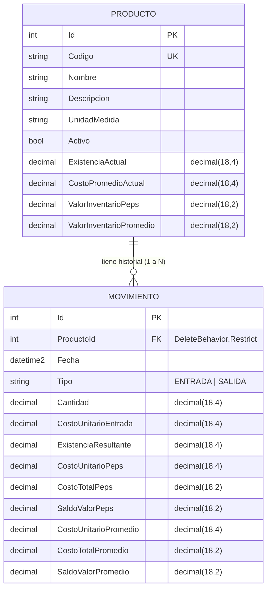

# Evidencia Técnica — SI-007: Modelo de Datos de Movimientos

## 1. Resumen del Ticket
- **ID:** `SI-007`
- **Release:** `v0.1.0` (Datos y ambiente de pruebas)
- **Objetivo:** Guardar cada entrada y salida con los datos exigidos por **RB-04** y persistir los resultados de ambos métodos de costeo (**PEPS** y **Costo Promedio Ponderado**) para auditoría y consulta histórica (**RF-05**).
- **Trazabilidad:** `RF-02`, `RF-03`, `RF-05`, `RB-04`, `RB-05`, `RB-08`, `RNF-01`.

---

## 2. Diagrama Entidad-Relación



---

## 3. Especificación de Columnas y Precisiones (Política §5.2)

| Columna | Tipo de Dato C# | Tipo SQL Server | Precision / Scale | Propósito / Regla de Negocio |
|---|---|---|:---:|---|
| `Id` | `int` | `int IDENTITY(1,1)` | — | Clave primaria |
| `ProductoId` | `int` | `int` | — | Clave foránea hacia `Productos` (`DeleteBehavior.Restrict`) |
| `Fecha` | `DateTime` | `datetime2` | — | Fecha y hora de registro cronológico |
| `Tipo` | `TipoMovimiento` | `nvarchar(10)` | — | Enum mapeado a string: `Entrada` o `Salida` |
| `Cantidad` | `decimal` | `decimal(18,4)` | 18 / 4 | Cantidad movilizada (soporte granel, RB-01) |
| `CostoUnitarioEntrada` | `decimal` | `decimal(18,4)` | 18 / 4 | Costo de adquisición (solo entradas, RB-02) |
| `ExistenciaResultante` | `decimal` | `decimal(18,4)` | 18 / 4 | Stock físico remanente tras la operación |
| `CostoUnitarioPeps` | `decimal` | `decimal(18,4)` | 18 / 4 | Costo unitario asignado por capas FIFO |
| `CostoTotalPeps` | `decimal` | `decimal(18,2)` | 18 / 2 | Importe total de salida/entrada PEPS |
| `SaldoValorPeps` | `decimal` | `decimal(18,2)` | 18 / 2 | Valor patrimonial total en inventario PEPS |
| `CostoUnitarioPromedio` | `decimal` | `decimal(18,4)` | 18 / 4 | Costo unitario ponderado móvil vigente |
| `CostoTotalPromedio` | `decimal` | `decimal(18,2)` | 18 / 2 | Importe total de salida/entrada Promedio |
| `SaldoValorPromedio` | `decimal` | `decimal(18,2)` | 18 / 2 | Valor patrimonial total en inventario Promedio |

---

## 4. Evidencia de Migración DDL (`20261018001237_AgregarMovimientos.cs`)

Fragmento generado por Entity Framework Core que confirma las precisiones, índices y la restricción de integridad referencial:

```csharp
migrationBuilder.CreateTable(
    name: "Movimientos",
    columns: table => new
    {
        Id = table.Column<int>(type: "int", nullable: false)
            .Annotation("SqlServer:Identity", "1, 1"),
        ProductoId = table.Column<int>(type: "int", nullable: false),
        Fecha = table.Column<DateTime>(type: "datetime2", nullable: false),
        Tipo = table.Column<string>(type: "nvarchar(10)", maxLength: 10, nullable: false),
        Cantidad = table.Column<decimal>(type: "decimal(18,4)", precision: 18, scale: 4, nullable: false),
        CostoUnitarioEntrada = table.Column<decimal>(type: "decimal(18,4)", precision: 18, scale: 4, nullable: false),
        ExistenciaResultante = table.Column<decimal>(type: "decimal(18,4)", precision: 18, scale: 4, nullable: false),
        CostoUnitarioPeps = table.Column<decimal>(type: "decimal(18,4)", precision: 18, scale: 4, nullable: false),
        CostoTotalPeps = table.Column<decimal>(type: "decimal(18,2)", precision: 18, scale: 2, nullable: false),
        SaldoValorPeps = table.Column<decimal>(type: "decimal(18,2)", precision: 18, scale: 2, nullable: false),
        CostoUnitarioPromedio = table.Column<decimal>(type: "decimal(18,4)", precision: 18, scale: 4, nullable: false),
        CostoTotalPromedio = table.Column<decimal>(type: "decimal(18,2)", precision: 18, scale: 2, nullable: false),
        SaldoValorPromedio = table.Column<decimal>(type: "decimal(18,2)", precision: 18, scale: 2, nullable: false)
    },
    constraints: table =>
    {
        table.PrimaryKey("PK_Movimientos", x => x.Id);
        table.ForeignKey(
            name: "FK_Movimientos_Productos_ProductoId",
            column: x => x.ProductoId,
            principalTable: "Productos",
            principalColumn: "Id",
            onDelete: ReferentialAction.Restrict);
    });

migrationBuilder.CreateIndex(
    name: "IX_Movimientos_Producto_Fecha_Id",
    table: "Movimientos",
    columns: new[] { "ProductoId", "Fecha", "Id" });
```

---

## 5. Evidencia de Ejecución de Pruebas Automatizadas

Ejecución de la suite completa xUnit en Release:

```text
Serie de pruebas para SI.Tests.dll (.NETCoreApp,Version=v8.0)
VSTest 17.11.1 (arm64)

- SI.Tests.IntegrationTests.SchemaTests.MovimientoSchemaTests.Movimiento_Schema_DebeExistirEnContexto [PASS]
- SI.Tests.IntegrationTests.SchemaTests.MovimientoSchemaTests.Movimiento_Schema_DebeTenerPrecisionDecimalCorrecta [PASS]
- SI.Tests.IntegrationTests.SchemaTests.ProductoSchemaTests.Producto_Schema_DebeExistirEnContexto [PASS]
- SI.Tests.RegressionTests.Def001PrecisionProductoTests.Producto_Schema_DebeTenerPrecisionDecimalCorrecta [PASS]
- SI.Tests.UnitTests.TestCase.IsTesting_EnvironmentWorking_ReturnTrue [PASS]

Total: 5. Aprobadas: 5. Fallidas: 0. Omitidas: 0. Duración: 259 ms.
```

---

## 6. Certificación QA
- [x] **RB-04 cumplido:** Relación 1:N obligatoria con protección de borrado `Restrict`.
- [x] **RB-08 y §5.2 cumplidos:** 10 columnas decimales validadas por contrato con `decimal(18,4)` y `decimal(18,2)`.
- [x] **RF-05 soportado:** Índice compuesto para optimización de consultas de Kardex e histórico.
