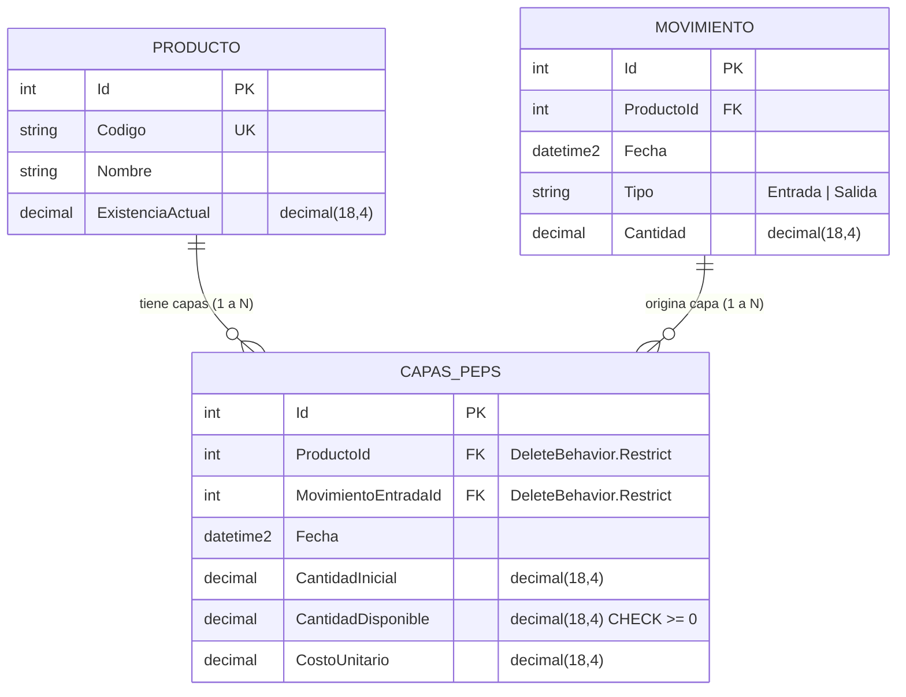

# Evidencia Técnica — SI-008: Modelo de Datos de Capas PEPS

## 1. Resumen del Ticket
- **ID:** `SI-008`
- **Release:** `v0.1.0` (Datos y ambiente de pruebas)
- **Objetivo:** Mantener las capas de inventario con su cantidad disponible y costo unitario conforme a la definición formal del método **PEPS (FIFO)**, garantizando orden cronológico estricto y protección contra cantidades negativas.
- **Trazabilidad:** `RF-04` (Métodos de costeo PEPS), `RB-07` (Costo según método), `RB-08` (Precisión decimal), `RNF-01` (Integridad).

---

## 2. Diagrama Entidad-Relación



---

## 3. Especificación de Columnas, Precisiones y Restricciones

| Columna | Tipo C# | Tipo SQL Server | Precision / Scale | Restricción / Propósito |
|---|---|---|:---:|---|
| `Id` | `int` | `int IDENTITY(1,1)` | — | Clave primaria |
| `ProductoId` | `int` | `int` | — | FK a `Productos` (`OnDelete: Restrict`) |
| `MovimientoEntradaId` | `int` | `int` | — | FK a `Movimientos` de entrada que originó la capa (`OnDelete: Restrict`) |
| `Fecha` | `DateTime` | `datetime2` | — | Fecha de ingreso para ordenación FIFO |
| `CantidadInicial` | `decimal` | `decimal(18,4)` | 18 / 4 | Cantidad original de la entrada (soporte granel, RB-08) |
| `CantidadDisponible` | `decimal` | `decimal(18,4)` | 18 / 4 | Stock remanente en la capa. **CHECK (`[CantidadDisponible] >= 0`)** |
| `CostoUnitario` | `decimal` | `decimal(18,4)` | 18 / 4 | Costo de adquisición de la capa (RB-08) |

### Restricciones e Índices en Base de Datos:
1. **Check Constraint:** `CK_CapasPeps_CantidadDisponible_NoNegativa`: `[CantidadDisponible] >= 0` (impide por contrato de base de datos que una capa quede en números negativos).
2. **Índice FIFO:** `IX_CapasPeps_Producto_Fecha_Id` sobre `(ProductoId, Fecha, Id)` para optimizar la recuperación por orden de antigüedad.

---

## 4. Evidencia de Migración DDL (`20261018011057_AgregarCapasPeps.cs`)

Fragmento generado por Entity Framework Core que confirma las precisiones, llaves foráneas y el check constraint:

```csharp
migrationBuilder.CreateTable(
    name: "CapasPeps",
    columns: table => new
    {
        Id = table.Column<int>(type: "int", nullable: false)
            .Annotation("SqlServer:Identity", "1, 1"),
        ProductoId = table.Column<int>(type: "int", nullable: false),
        MovimientoEntradaId = table.Column<int>(type: "int", nullable: false),
        Fecha = table.Column<DateTime>(type: "datetime2", nullable: false),
        CantidadInicial = table.Column<decimal>(type: "decimal(18,4)", precision: 18, scale: 4, nullable: false),
        CantidadDisponible = table.Column<decimal>(type: "decimal(18,4)", precision: 18, scale: 4, nullable: false),
        CostoUnitario = table.Column<decimal>(type: "decimal(18,4)", precision: 18, scale: 4, nullable: false)
    },
    constraints: table =>
    {
        table.PrimaryKey("PK_CapasPeps", x => x.Id);
        table.CheckConstraint("CK_CapasPeps_CantidadDisponible_NoNegativa", "[CantidadDisponible] >= 0");
        table.ForeignKey(
            name: "FK_CapasPeps_Movimientos_MovimientoEntradaId",
            column: x => x.MovimientoEntradaId,
            principalTable: "Movimientos",
            principalColumn: "Id",
            onDelete: ReferentialAction.Restrict);
        table.ForeignKey(
            name: "FK_CapasPeps_Productos_ProductoId",
            column: x => x.ProductoId,
            principalTable: "Productos",
            principalColumn: "Id",
            onDelete: ReferentialAction.Restrict);
    });

migrationBuilder.CreateIndex(
    name: "IX_CapasPeps_Producto_Fecha_Id",
    table: "CapasPeps",
    columns: new[] { "ProductoId", "Fecha", "Id" });
```

---

## 5. Evidencia de Ejecución de Pruebas Automatizadas (xUnit)

Ejecución de la suite completa xUnit en Release (8/8 pruebas aprobadas):

```text
Serie de pruebas para SI.Tests.dll (.NETCoreApp,Version=v8.0)
VSTest 17.11.1 (arm64)

- SI.Tests.IntegrationTests.SchemaTests.CapasPepsSchemaTests.CapasInventarioPeps_Schema_DebeExistirEnContexto [PASS]
- SI.Tests.IntegrationTests.SchemaTests.CapasPepsSchemaTests.CapasInventarioPeps_Schema_DebeTenerPrecisionesDecimalesCorrectas [PASS]
- SI.Tests.IntegrationTests.SchemaTests.CapasPepsSchemaTests.CapasInventarioPeps_Schema_DebeTenerRelacionesYCheckConstraint [PASS]
- SI.Tests.IntegrationTests.SchemaTests.MovimientoSchemaTests.Movimiento_Schema_DebeExistirEnContexto [PASS]
- SI.Tests.IntegrationTests.SchemaTests.MovimientoSchemaTests.Movimiento_Schema_DebeTenerPrecisionDecimalCorrecta [PASS]
- SI.Tests.IntegrationTests.SchemaTests.ProductoSchemaTests.Producto_Schema_DebeExistirEnContexto [PASS]
- SI.Tests.RegressionTests.Def001PrecisionProductoTests.Producto_Schema_DebeTenerPrecisionDecimalCorrecta [PASS]
- SI.Tests.UnitTests.TestCase.IsTesting_EnvironmentWorking_ReturnTrue [PASS]

Total: 8. Aprobadas: 8. Fallidas: 0. Omitidas: 0. Duración: 276 ms.
```

---

## 6. Certificación QA
- [x] **RB-07 y RF-04 soportados:** Estructura de capas FIFO lista con índice de antigüedad `(ProductoId, Fecha, Id)`.
- [x] **RNF-01 garantizado:** Restricción DDL `[CantidadDisponible] >= 0` verificada en base de datos.
- [x] **RB-08 cumplido:** Precisiones decimales `decimal(18,4)` validadas por contrato con pruebas automatizadas.
